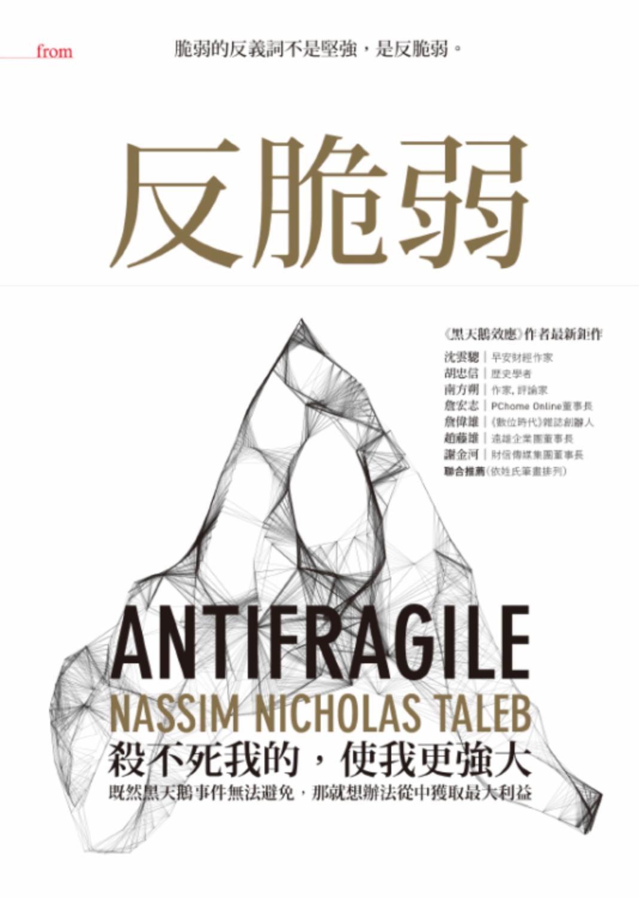

# 《反脆弱：脆弱的反義詞不是堅強，是反脆弱》重點整理

- **作者**：納西姆．尼可拉斯．塔雷伯（Nassim Nicholas Taleb），《黑天鵝效應》作者
- **譯者**：羅耀宗
- **出版**：大塊文化，2013（原書 *Antifragile*, 2012）

!!! abstract "一句話總結"

    **每一件事都會從波動中得利或受損。** 脆弱的東西因波動、隨機、錯誤、壓力和時間而受損；反脆弱的東西則因它們而變得更好。既然黑天鵝無法預測，與其預測，不如讓自己變得反脆弱。

---

## 全書架構

| 冊 | 主題 | 章節 |
|---|---|---|
| 前言 | 反脆弱的定義、三元組 | — |
| 第一冊 | 反脆弱：導讀 | 1–4 |
| 第二冊 | 現代化與否定反脆弱性 | 5–8 |
| 第三冊 | 非預測的世界觀 | 9–11 |
| 第四冊 | 可選擇性、技術與反脆弱的智慧 | 12–17 |
| 第五冊 | 非線性與非線性（較技術性） | 18–19 |
| 第六冊 | 否定法 | 20–22 |
| 第七冊 | 脆弱性與反脆弱性的倫理 | 23–24 |
| 結語、後記 | 全書濃縮、胖子東尼之死 | 25、後記 |

### 核心工具：三元組（Triad）

| 脆弱 | 強固 | 反脆弱 |
|---|---|---|
| 達摩克里斯之劍 | 菲尼克斯（浴火重生） | 海德拉（砍一頭長兩頭） |
| 討厭錯誤 | 錯誤只是資訊 | 喜愛小錯誤 |
| 集權的單一民族國家 | — | 城邦、分權 |
| 醫療用加法（給藥） | — | 醫療用減法（否定法） |
| 企業員工 | 牙醫 | 計程車司機、技術勞工 |
| 債務 | 股本 | 創業投資 |
| 賣出選擇權 | — | 買進選擇權 |
| 創傷後壓力 | — | 創傷後成長 |
| 羅伯．摩西（由上而下的都市規劃） | — | 珍．雅各（有機生長的都市） |

---

## 前言

**核心觀點：有些事物不只承受得住波動，還會從中獲益。我們該做的是辨識並降低脆弱，而不是去預測。**

- **風與火**：風會吹熄蠟燭，卻會讓火燒得更旺。面對不確定時，要當火。
- **新詞「反脆弱」**：英文的 fragile 沒有真正的反義詞。強固（robust）、堅韌（resilient）只是在衝擊下維持原狀，反脆弱則會變得更好。進化、文化、都市、法律體系、細菌的抗藥性都有這種特質。
- **不對稱性測試**：隨機事件帶來的**上檔利益多於下檔損失**，就是反脆弱，反之就是脆弱。稀有事件無法計算，但脆弱性**可以察覺**。
- **剝奪壓力反而有害**：就像臥床一個月會肌肉萎縮。由上而下的政策（作者稱為「蘇聯—哈佛妄想」）讓經濟、健康和教育都變脆弱。
- **脆弱推手（fragilista）**：把未知當作不存在、過度相信理性與模型的人。
- **切身利害**：社會最大的脆弱來源，是有人拿走上檔利益、讓別人承擔下檔損失。首要的倫理準則是：**不得靠別人的脆弱換取自己的反脆弱**。
- **混亂家族**：包括不確定、變異、波動、隨機、錯誤、壓力因子、時間、未知等。反脆弱的東西喜歡這些。
- 本書是作者「不確定」（Incerto）系列的中心著作，《黑天鵝效應》只是它的補充。

---

## 第一冊｜反脆弱：導讀

介紹反脆弱的特質、有機與機械的差別，以及整體的反脆弱往往要靠部分的脆弱。

### 第1章｜達摩克里斯與海德拉之間
**核心觀點：「脆弱」的真正反義詞是會因傷害而受益的「反脆弱」。人類有這種直覺，只是語言沒有為它命名。**
- **包裹思想實驗**：易碎品要寫「小心搬運」，反脆弱的包裹就該寫「請粗暴處理」。
- **三則神話**：達摩克里斯（脆弱）、菲尼克斯（強固）、海德拉（反脆弱）。貝魯特被毀七次又重建，重建時還挖出了羅馬法學院，比原本更好。
- **沒有名字不等於不懂**：荷馬沒有「藍」字，所以寫「酒暗色的海洋」。我們只是在知識上看不見反脆弱，本能上其實懂。
- **米特拉達提斯化**：長期服用微量毒物以防毒殺，和疫苗的道理一樣，屬於強固層級。
- **毒物興奮效應（hormesis）**：少量有害物質反而讓身體更好。作者認為這是常態，缺乏它才傷身。
- **領域相依（domain dependence）**：同一個觀念換了情境就認不出來。例如讓服務生拖行李、卻在健身房甩壺鈴的銀行家；鼓勵你運動，卻為小感染開抗生素的醫生。

### 第2章｜每個地方都有過度補償和過度反應
**核心觀點：反脆弱來自對壓力的過度補償，而過度補償本質上就是一種備餘。**
- **創傷後成長**：與創傷後壓力相反的現象。
- **創新來自需要**：有麻煩，但不是會毀掉你的那種麻煩。例如飛機自動化讓駕駛技巧退化；要把事情交給最忙的人；在咖啡廳的雜訊中工作反而更專注。
- **備餘（redundancy）**：例如人有兩個腎臟。債務是備餘的反面。
- **盧克萊修問題**：把見過最高的山當成世界最高的山，例如福島核電廠只依過去最大的地震設計。人類打的是上一場戰爭，大自然打的是下一場。
- **舉重**：每次試著突破上限，身體就會為下一個更高的重量做準備。
- **鎮壓、禁書、愛情**也都具反脆弱性：越被壓抑、禁止、批評，越強烈、越暢銷。
- **聲譽**：作家幾乎不怕醜聞，西裝筆挺的主管卻很脆弱。高喊「重振信心」反而暴露自己的脆弱。

### 第3章｜貓與洗衣機
**核心觀點：有機與深奧系統（貓）需要壓力和隨機性。把它們當成機械（洗衣機）管理、抽掉所有波動，反而會讓它們衰弱。**
- 沃爾夫定律：骨頭承受壓力後會變得更密，太空人的骨頭則會變弱。
- 很多「老化」其實是**失調**，也就是壓力太少或恢復不足。衰老無法避免，失調可以避免。
- **深奧系統**相互依存、因果不透明，例如山區的獅子被消滅後，山羊暴增，森林跟著消失。
- **急性勝過慢性**：短暫的強壓力加上充分恢復有益；通勤、電子郵件這類持續性的小壓力有害。
- 機械因使用而磨損，有機體因不使用而衰退。
- 作者也批評用藥物壓平孩子的情緒波動。
- **觀光化（touristification）**：把隨機性從生活中抽走，照劇本過日子。

### 第4章｜害死我的，使別人更強大
**核心觀點：反脆弱是分層的。整體（物種、產業）的反脆弱，靠的是個體的脆弱與犧牲。**
- 單一餐廳很脆弱，整個餐飲業卻因此反脆弱。個體會死，基因資訊卻具有反脆弱性。
- 進化不必預測，靠世代更替篩選。
- **好系統的錯誤是局部的**，例如每次空難都讓下一次更不可能發生。**壞系統的錯誤會傳染**，例如銀行倒閉的連鎖效應。
- 經濟需要個體局部的過度自信。政府紓困大企業則正好相反，把風險移回集體。
- 尼采「殺不死我的，使我更強大」可能只是倖存者偏誤。
- 作者提議設立**全國創業日**：失敗的創業家應該像陣亡士兵一樣被紀念。

---

## 第二冊｜現代化與否定反脆弱性

以普羅克拉斯提斯之床為喻：好意的管理者把有機體當機器、剝奪它的波動，反而讓系統更容易被黑天鵝重創。

### 第5章｜露天市場與辦公大樓
**核心觀點：人為消除隨機性，只是把可見的小波動換成隱藏的大風險。**
- **雙胞胎**：一個是銀行員，收入穩定，但一通電話就可能歸零；一個是計程車司機，收入起伏大，卻經得起衝擊。人生的核心錯覺，就是以為隨機等於風險。
- **瑞士**由下而上治理，地方小摩擦不斷，整體卻極為穩定。
- 規模不能線性放大：小社群有羞恥心，大官僚只看數字。
- **平常世界**的變異會互相抵銷；**極端世界**平時平靜，偶有巨大跳動，例如約 0.1% 的書占了一半以上的銷量。
- **火雞問題**：火雞被餵了一千天，信心最高時迎來感恩節。沒有傷害的證據，不等於證明沒有傷害。
- 敘利亞拆掉露天市場改建辦公大樓，商人隨即外移；混亂的黎巴嫩反而比較富裕。

### 第6章｜告訴他們我愛（若干）隨機性
**核心觀點：嚴密控制會引發爆炸，適量的隨機性反而讓系統更穩定。**
- 馬克士威證明，太緊密地控制蒸汽機反而不穩定。
- 森林小火能清除易燃物；市場下跌能把脆弱的人洗出場。
- **布利登的驢子**：站在食物和水正中間的驢子會餓死，隨機推牠一把就能得救。
- 隨機共振、模擬退火、雅典議員以抽籤選出，都是善用隨機性的例子。
- 美國為了「穩定」支持獨裁政權，但穩定就像貸款，終究要償還。
- **現代化**的核心，就是窒息波動、否定反脆弱性。

### 第7章｜天真的干預
**核心觀點：所有干預都帶有醫療傷害。問題在於不計後果的天真干預，以及把雜訊當成訊號。**
- **扁桃腺研究**：同一批孩子換一批醫生檢查，總是有大約一半被建議開刀。
- **醫療傷害（iatrogenics）**：治療的傷害大於利益。例如華盛頓死於放血；塞梅爾威斯發現醫生沒洗手會害死產婦，卻遭到排斥。這個概念也適用於政治、經濟和都市規劃。
- 葛林斯潘想消滅景氣循環，作者稱他為脆弱推手。
- **讚美拖延**：拖延是天然的過濾器。作者靠健行和舉重治好背痛，免了手術。
- **資訊看得越頻繁，雜訊比例越高**：以年度來看大約一半是訊號，每天看約 95% 是雜訊，每小時看則高達 99.5%。
- 不要把觸媒誤當成起因：壓垮橋的不是最後那輛貨車，而是被壓抑的脆弱。

### 第8章｜預測是現代化的產物
**核心觀點：與其預測黑天鵝，不如降低自己對預測錯誤的脆弱性。**
- 作者聽完官員對未來五年的經濟預測後當場發火，由此想出三元組。
- 就算明知數字是隨機的，拿到預測的人仍會冒更大的風險。
- **備餘是一種非預測的行為**：有現金和存糧的人不必預測災難；負債的人則必須預測得很準。
- 不要妄想改變人性，而是讓世界經得起貪婪。
- 沒預見海嘯情有可原，蓋出怕海嘯的東西才不可原諒。
- **第四象限**：極端世界的隨機性加上高度暴露，在這裡預測不可行。

---

## 第三冊｜非預測的世界觀

### 第9章｜胖子東尼和脆弱推手
**核心觀點：未來雖然無法預測，但可以預測依賴預測的人會出事。**
- 胖子東尼不愛讀書，卻能「嗅出」脆弱；尼洛則是藏書約一萬五千本的博學者。兩人都押注 2008 年危機，東尼賺了約一億美元。
- 東尼認為不必事先警告冤大頭，要拿走他們的錢，他們才會尊重你。
- 一個人值得多少尊敬，取決於他為自己的意見承擔多少下檔風險。
- 尼洛旅行時不排行程，好奇心本身也具反脆弱性。

### 第10章｜塞內加的上檔利益和下檔損失
**核心觀點：斯多噶哲學不只是強固，而是一種反脆弱：砍掉命運帶來的下檔損失，保留上檔利益。**
- 塞內加是羅馬最富有的人之一，卻在心理上先把財物「拋開」，旅行時只帶船難後也會有的東西。
- 擁有越多就越脆弱，因為失去的痛苦大於得到的快樂。作者上班前就先寫好辭職信。
- 斯多噶是馴服情緒，不是消除情緒：把恐懼化為謹慎、痛苦化為資訊、錯誤化為啟示、渴望化為行動。
- **基礎不對稱**：失大於得就是脆弱，得大於失就是反脆弱。

### 第11章｜不要和搖滾明星結婚
**核心觀點：槓鈴策略一端極度保守、一端極度冒險，避開中段：先消除毀滅風險，再讓正面的黑天鵝自己發生。**
- 第一步是**降低下檔損失**，而不是追求上檔利益。脆弱有路徑相依性，壞了就回不去，所以生存優先。
- 財務槓鈴：**90% 放極安全的資產，10% 放極高風險的標的**，最大損失可以預知；全部押在「中等風險」反而可能全毀。
- 有些一夫一妻制的鳥，有一成以上的幼鳥不是名義上的父親所生，好比「90% 會計師、10% 搖滾明星」。
- 寫作者的槓鈴：找份閒差，其餘時間寫作，例如卡夫卡在保險公司上班、斯賓諾莎靠磨鏡片維生。
- 個人槓鈴：不抽菸、不吃糖、不騎機車，專業上的風險則勇於承擔。
- 為最壞的情況做準備，最好的事會自己照顧自己。

---

## 第四冊｜可選擇性、技術與反脆弱的智慧

不需要知道自己要往哪裡去，只要握有「有權利、沒有義務」的不對稱報償，再理性地留下好的結果，就能從不確定性中得利。作者藉此反駁「目的論謬誤」，也就是誤以為人都清楚自己要往哪裡去。

### 第12章｜泰勒斯的甜葡萄
**核心觀點：選擇權是反脆弱性的代理人。不對稱加上理性，就能用可選擇性取代知識。**
- 泰勒斯花一點訂金預訂所有榨油機，大豐收時轉租獲利。作者認為他靠的不是天文知識，而是選擇權。
- 選擇權是**有權利、沒有義務**。做對時報償大，所以不必常常做對。
- 最好的選擇權往往免費或很便宜，例如開放式的派對邀約、可以隨時退租的租約。不確定性越高，選擇權越有價值。
- **自由是終極的選擇權**，「×錢」指的是錢多到足以換得獨立。
- 大自然靠試誤與篩選運用選擇權（拼裝，bricolage）。
- 選擇權喜歡離散，不在乎平均數，例如書的銷量不會是負數。

### 第13章｜教鳥如何飛
**核心觀點：技術多半來自修補與實作，學術界卻宣稱是理論帶出實務。**
- **旅行箱裝輪子**：輪子發明近六千年後才有人把它裝到行李箱上。簡單的東西事後看來理所當然，事前卻看不見。
- **半發明**：從發現到執行之間有很大的缺口，例如從發現病菌到被接受為致病原因，隔了很久。
- 試誤不等於隨機：每排除一個選項，成功機率就提高。
- **蘇聯—哈佛鳥類學系**：教授教鳥飛，再把鳥會飛歸功於自己，而鳥不會寫論文。
- **副現象（epiphenomena）**：誤把伴隨出現的事當成原因，例如以為羅盤在指揮航向。
- 只挑好的說（cherry-picking）本身就是一種可選擇性。

### 第14章｜當兩件事不是「同一回事」
**核心觀點：知識和從知識得到的報償不是同一回事（綠木材謬誤）。**
- 證據顯示是財富帶來教育，而不是教育帶來國家財富。例如 1960 年台灣的識字率比菲律賓低，今天所得是菲律賓的十倍。
- **綠木材謬誤（green lumber fallacy）**：最成功的綠木材交易員，以為那是漆成綠色的木材。很多頂尖交易員連交易標的國家在哪裡都不知道。
- 胖子東尼在波灣戰爭時反向押注油價，30 萬美元變成 1,800 萬美元。科威特和石油不是同一回事。
- 事物本身和它的函數（例如價格）不同，不對稱越大，差距越大。
- 普羅米修斯（先見，代表可選擇性）對照伊皮米修斯（後見，代表事後敘事）。

### 第15章｜輸家寫的歷史
**核心觀點：科技史常把實作者的成果歸給理論家。創新主要來自業餘者與試誤。**
- 噴射引擎、大教堂建築、選擇權定價公式都是實作先於理論。作者與合著者證明，交易員早在公式出現前至少一個世紀就會這套。
- 大多數技術像**烹飪**，靠代代修補演化，像物理那樣由理論推導的是少數例外。
- 工業革命的推手多是業餘愛好者與英國教區牧師。
- **資助人，而不是計畫**；在極端世界裡要分散到大量嘗試上（1/N）。
- 尼克森「向癌症宣戰」後篩選了大量植物萃取物，成效有限，有效的藥物卻常是意外發現的。
- 準則：尋找可選擇性與開放式報償、投資於人、採用槓鈴策略。

### 第16章｜混亂中的秩序
**核心觀點：在教室學到的技能多半留在教室裡。真正的學習是槓鈴式的自學。**
- 技能有**領域特異性**：棋下得好，不代表推理更好。
- 「足球媽媽」把試誤從孩子的生活中移除。被關起來的獅子活得比較久，卻不是真正活著。
- 作者的槓鈴自學法：考試剛好及格，其餘時間大量閱讀自己有興趣的書，厭倦了就換一本，但不停止閱讀。
- 健身房練出大肌肉的人，未必搬得動石頭。
- 寶藏總是在主流之外。

### 第17章｜胖子東尼和蘇格拉底辯論
**核心觀點：不能理解，不等於愚蠢。真實生活重要的是報償與暴露程度，而不是真或假。**
- 蘇格拉底要求事物的定義，胖子東尼則反問：嬰兒不必定義母奶也會喝奶。
- 尼采批評蘇格拉底，並以酒神精神代表修補與隨機的力量。
- **決策要看脆弱性，不是機率**：例如飛航安全不能用 95% 信賴水準來判斷。
- 與其追求更準的預測，不如**修改自己的暴露程度**。
- 鬼扯是脆弱的，終將崩潰。

---

## 第五冊｜非線性與非線性

作者把他早年分析衍生性商品非線性曝險的工具，延伸成察覺任何事物脆弱性的方法。作者也註明，不想看技術內容的讀者可以跳過本冊。

### 第18章｜一塊大石頭和一千顆小石子的不同
**核心觀點：脆弱性源自非線性。對脆弱的東西來說，一次大衝擊的傷害遠大於許多次小衝擊加總（凹性）；反脆弱則相反（凸性）。**
- 國王與石頭的故事：把大石頭切成小石子丟，就不會砸死人。車子以時速 50 哩撞牆一次，比以時速 5 哩撞十次更糟。
- 存在至今的脆弱事物，必然對小衝擊幾乎無感，只怕極端事件。
- **反脆弱的例子**：衝刺比慢走對健康更好，即使平均速度相同。
- **凸性**像微笑，代表喜歡波動；**凹性**像噘嘴，代表怕波動。
- **交通**：車流增加 10%，通勤時間可能暴增 50%。過度優化、沒有備餘的系統，一點小擾動就會崩潰。
- **規模造成脆弱**：興業銀行被迫倉促出清約 700 億美元的部位，損失約 60 億美元；同樣的事如果分散在十家小銀行，損失幾乎為零。
- **專案延誤是單向的**：飛機最多早到 20 分鐘，卻可能晚到好幾個小時。伊拉克戰爭預估花費 300–600 億美元，實際可能超過 2 兆美元。

### 第19章｜點金石與反點金石
**核心觀點：只要看「誤差變大時傷害是否加速」，即使模型錯了也能測出脆弱性。凸性帶來的隱形優勢就是點金石。**
- **房利美**：作者看過它的風險報告後指出，經濟變數一往上，虧損就加速擴大，斷言它「坐在一桶炸藥上」，後來果然倒閉。
- **脆弱性察覺試探法**：如果每多一單位的壓力，傷害就加速增加，那就是脆弱。這個方法可以用在赤字、槓桿等領域。
- 刻度不準的尺量不準身高，卻看得出孩子有沒有在長高，所以衡量二階效應不需要完美的模型。
- 平均氣溫 21°C，可能是極冷加極熱的平均。**河的平均深度是四呎，也不要過河**。
- **詹森不等式**：報償是凸函數時，「平均的報償」大於「平均值的報償」。所以握有凸性報償的人，即使預測比隨機還差也能勝出。
- 人可以很笨，只要具備反脆弱性，表現仍會很好。

---

## 第六冊｜否定法（via negativa）

源自神學傳統：不說上帝是什麼，只說祂不是什麼。高手靠避免犯錯取勝；知識靠減法成長，因為反證比證實更可靠。少數 1% 的部分常造成 99% 的效果。決策試探法：**做一件事如果需要一個以上的理由，就不要做。**

### 第20章｜時間與脆弱性
**核心觀點：預言應該用減法，判斷什麼脆弱、會被時間淘汰。對不易損的東西而言，存在越久，預期還能存在越久。**
- **嗜新狂（neomania）**：人們想像未來時，總是在現在之上加入新科技。但一頓晚餐用到的鞋子、杯子、椅子、火、葡萄酒，都有數千年歷史。
- **林迪效應（Lindy effect）**：人每多活一天，剩餘壽命就縮短；書、技術、觀念每多存在一天，預期壽命反而變長。已經印行 40 年的書，可望再印 40 年。
- 人們注意變動的東西，忽略不變但更重要的東西。**跑步機效應**讓人不斷追求升級。
- 最好的技術是隱形的，用來抵消先前技術的害處，例如模仿赤腳的鞋子。
- 現代建築平滑且由上而下，自然生長的事物則具有碎形特質。呎、磅這些舊單位貼近人體尺度。
- **用時間過濾讀物**：一年內出版的書通常不值得讀。
- **先知**的本義是警告現在的人，不是預測未來的人。

### 第21章｜醫療、凸性和不透明
**核心觀點：醫療只在利益巨大時（重症）才具有正凸性。對接近健康的人，傷害容易大過好處，而舉證責任應該落在不自然的干預這一方。**
- 不能把「沒有傷害的證據」當成「證明沒有傷害」。
- **醫療傷害第一原則**：不需要等到傷害出現，就可以說不自然的療法危險，因為好處小而可見，傷害卻大而延後（例如反式脂肪、沙利竇邁）。
- **醫療傷害第二原則**：輕度高血壓患者服藥受益的機率約 5.6%，重度患者約 72%，所以只該冒險治療重症。
- 呼吸器採用高低變動的壓力，比固定壓力更有效（詹森不等式在醫療上的應用）。
- **大自然做的事，在證明有錯之前都算對；人類做的事，在證明沒錯之前都算有瑕疵。**
- 現象比理論強固：舉重長肌肉這種效應一直都在，解釋它的理論卻不斷更換。

### 第22章｜活得久，但不是太久
**核心觀點：延長生命最可靠的做法是減法：去除不自然的東西、偶爾隨機禁食。**
- 壽命延長主要來自公共衛生、盤尼西林、重症醫療，不能歸功於所有醫療。醫院罷工期間只做急診，死亡率並沒有上升。
- 勸人**戒菸**可能是六十年來最大的醫療貢獻。削減非急需的醫療，可能延長富國人民的壽命。
- 作者的個人準則：不吃沒有古老名稱的食物，只喝歷史超過千年的飲料（水、葡萄酒、咖啡）。叫「健康」的東西通常不健康。
- **隨機營養**：獅子隨機進食，牛穩定進食。希臘東正教一年約 200 天的禁食，可能才是地中海飲食的關鍵。
- 舒適與財富也有醫療傷害。
- 作者反對追求永生：個體的脆弱成就了群體的反脆弱，人應該留下子女或書。

---

## 第七冊｜脆弱性與反脆弱性的倫理

世界越不透明，越有人能把風險轉嫁給別人而不受法律約束。唯一的解方是「切身利害」，這也正是近 3,800 年前漢摩拉比法典的精神。

### 第23章｜切身利害：反脆弱性和犧牲他人的可選擇性
**核心觀點：現代最嚴重的問題，是有人拿走上檔利益、把下檔損失轉給別人。解方是讓決策者承擔切身利害（skin in the game）。**
- **倫理三元組**：
  - 把損失轉給別人的人：官僚、顧問、高階主管、銀行家。
  - 自己承擔風險的人：工匠、創業家、交易員。
  - 為他人承擔風險的人：聖人、騎士、異議者。
- **漢摩拉比法則**：房子倒塌壓死屋主，建造者就要償命。因為建造者最清楚地基裡藏了什麼，而這條法則就是在事前消除隱藏風險的誘因。
- 胖子東尼的試探法：駕駛員不在機上，就不要登機。
- **空談者握有免費選擇權**：說錯了不必付代價，事後還能只挑說對的。對策是**不問他的意見，只看他的投資組合**；或者問醫生「如果你是我，你會怎麼做？」
- **史迪格里茲症候群**：給出壞建議卻不受懲罰，事後還宣稱早就預見危機。
- **重要的是報償，不是頻率**：脆弱的部位可能常常是對的，但一次就會被打垮。冤大頭想贏得爭論，非冤大頭只想贏。
- 把石頭誤認成熊無害，把熊誤認成石頭會致命：存活下來的是犯錯代價小的試探法。
- **企業經理人**的認股權讓他們只拿上檔利益，下檔由股東或納稅人承擔。公司沒有羞恥心，工匠有榮譽感。

### 第24章｜配適倫理到一種專業上
**核心觀點：人們常常先選好職業，再編出一套倫理替自己辯護（倫理倒置）。**
- 胖子東尼說，現代的奴隸打著領帶。自由人是沒辦法被逼著去做他本來不會做的事的人。
- **跑步機效應**：有錢人仍得不斷賺更多才能維持原地。
- 靠某個專業謀生的人，談公共事務時天生就值得懷疑。
- **艾倫．布林德問題**：前官員利用公職經驗合法謀利，混淆了倫理與法律。作者建議，出任公職的人日後的商務收入不得高於薪水最高的公務員。
- **詭辯就是一種可選擇性**：先問發言者能不能從自己的論點得到好處。發言違背自身利益時，則更值得重視。
- **巨量資料的陷阱**：資料越多，虛假的相關也越多；雜訊呈凸性成長，資訊呈凹性成長。
- 科學最不該用「大家都這麼想」當論據。

### 第25章｜結語
**核心觀點：全書可以濃縮成一句話：每一件事都會從波動得利或受損。**
- 「波動」可以換成混亂家族的任何成員。非線性的東西不是凸性就是凹性。
- 我們可能永遠不知道 X，但可以控制自己對 X 的暴露 f(x)，例如透過槓鈴策略。
- 隨機性應該分散，不應該集中；大的東西和快的東西都怕波動。
- **判斷自己是否還活著，就看是否喜歡變動。**

### 後記｜從復活到復活
- 胖子東尼死於主動脈瘤。一年後，尼洛在黎凡特參加他的週年紀念，那裡正好在舉行阿多尼斯的復活慶典。
- 東尼的遺產安排得毫無瑕疵：沒有債務，分配保守而公平。他另外留了一筆錢給尼洛，用於一項祕密而高尚的任務。

---

## 詞彙表精選

| 術語 | 英文 | 說明 |
|---|---|---|
| 三元組 | Triad | 脆弱、強固、反脆弱 |
| 基礎不對稱 | Fundamental Asymmetry | 上檔利益多於下檔損失就是反脆弱 |
| 脆弱推手 | Fragilista | 自以為懂，把變異從喜歡它的系統中移除的人 |
| 普羅克拉斯提斯之床 | Procrustean bed | 削足適履式的簡化 |
| 教鳥怎麼飛效應 | Lecturing-Birds-How-to-Fly Effect | 誤以為學術在先、實務在後 |
| 醫療傷害 | Iatrogenics | 干預造成的傷害多於益處 |
| 天真的干預主義 | Naive Interventionism | 不顧醫療傷害，偏好「做點事」 |
| 觀光化／理性的漫遊者 | Touristification / Rational flâneur | 前者抽走生活的隨機性；後者見機行事、保留選擇權 |
| 槓鈴策略 | Barbell Strategy | 一端極安全、一端極投機，避開中段 |
| 毒物興奮效應 | Hormesis | 適量的壓力使有機體更強 |
| 泰勒斯法 vs. 亞里士多德法 | Thalesian vs. Aristotelian | 前者重視暴露與報償，後者重視真假 |
| 事件與暴露混為一談 | Conflation of Event and Exposure | 把 f(x) 誤當成 x |
| 戲局謬誤 | Ludic Fallacy | 把賭場式的機率問題當成真實世界 |
| 火雞／反火雞 | Turkey / Inverse Turkey | 前者忽略負面黑天鵝，後者看不見正面機會 |
| 代理問題 | Agency Problem | 做對時自己受益，做錯時別人買單 |
| 切身利害 | Skin in the Game | 消除代理問題的方法 |
| 信念的許定 | Doxastic Commitment | 只相信會為錯誤付出代價的人的意見 |
| 綠木材謬誤 | Green Lumber Fallacy | 誤判哪些知識才真正相關 |
| 倫理倒置 | Ethical Inversion | 先有職業，再找倫理來配合 |
| 否定法 | Via negativa | 重在不做什麼、去除什麼 |
| 林迪效應 | Lindy Effect | 不易損的事物存在越久，預期壽命越長 |
| 嗜新狂 | Neomania | 為了改變而喜愛改變 |
| 平常世界／極端世界 | Mediocristan / Extremistan | 薄尾／厚尾 |
| 點金石（凸性偏誤） | Philosopher's Stone | 非線性或可選擇性帶來的隱形利益 |

---

## 附錄重點

- **劑量會反轉**：劑量超過某一點，利益就會變成傷害。在非線性之下，簡單地說某樣東西「好」或「不好」都會失真。
- **四類報償**：
  - 強固：兩尾都薄。
  - 脆弱第一型：兩尾都厚，很少見。
  - 脆弱第二型：左尾厚、右尾薄。
  - 反脆弱：右尾厚、左尾薄。
  - 即使不知道機率，也能用試探法判斷脆弱性。
- **修正 f(x) 比了解 x 容易**：地震的死亡人數比地震本身容易預測。
- **第四象限**：厚尾加上凹性暴露，是最危險的組合。
- **經濟模型的脆弱**：
  - 把估計出來的參數當成確定值，會低估風險。例如失業率在 8–10% 之間波動時，期望赤字遠高於用 9% 算出的數字。
  - 李嘉圖的比較優勢忽略了價格的隨機性，過度專業化的國家會面臨凹性暴露。
  - 投資組合理論過度相信相關性，長期資本管理公司（LTCM）就是例子。
- **小機率無法計算**：參數只要稍有誤差，十個標準差事件的機率就可能差上十億倍以上。

---

## 實用心法整理

1. **先察覺脆弱，不要預測**：問自己「誤差變大時，傷害會加速嗎？」
2. **槓鈴配置**：極度保守加小部分極度冒險，避開看似安全的中段。
3. **先求不毀滅**：降低下檔損失比追求上檔利益重要。
4. **保留選擇權**：找有權利、沒有義務、便宜甚至免費的機會；自由是終極選擇權。
5. **用減法**：少做、少吃、少干預、少看新聞；做一件事需要多個理由，就不要做。
6. **相信時間**：選擇經過時間考驗的書、工具和習慣（林迪效應）。
7. **擁抱適量壓力**：急性壓力加上充分恢復，避免慢性壓力；別讓生活觀光化。
8. **小錯誤要多犯、要分散**；避免會傳染的大錯誤。
9. **只聽有切身利害的人**：看他的投資組合，不聽他的意見。
10. **不要靠別人的脆弱換取自己的反脆弱。**

---

整理說明：依電子書全文整理，包含前言、第 1–25 章、後記、詞彙表與附錄一、二；附註與參考書目未納入。
