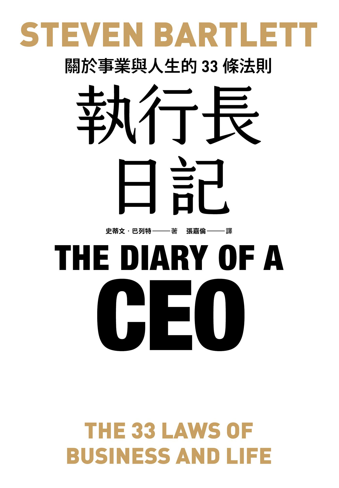

# 《執行長日記：關於事業與人生的33條法則》重點整理

- **作者**：史蒂文．巴列特（Steven Bartlett）
- **譯者**：張嘉倫
- **原書**：*The Diary of a CEO: The 33 Laws of Business and Life*

!!! info "說明"

    作者是播客「The Diary Of A CEO」的主持人，創立過多家行銷與科技公司（Flight Story、thirdweb、Flight Fund）。他說這不是一本講商業策略的書，講的是不會過時的法則，依據是心理學研究、他對數萬人做的調查，以及 700 小時的名人訪談。

---

## 全書架構：追求卓越的四大支柱

| 支柱 | 主題 | 章節 |
|---|---|---|
| 一、掌握自我 | 自我意識、自我控制、自我照顧、自我敘事 | 01–09 |
| 二、精通敘事 | 說故事、行銷、說服 | 10–18 |
| 三、確立人生哲學 | 引導行為的信念與價值觀 | 19–27 |
| 四、熟習團隊合作 | 用人、文化、領導 | 28–33 |

作者寫這本書的五個原則：書不該冗長、要化繁為簡、圖勝千言、故事比數據有力（但兩者都要）、重視細節。

---

## 支柱一：掌握自我

### 01｜按正確順序裝滿你的桶子
- 人生有五個桶子：**知識 → 技能 → 人脈 → 資源 → 聲望**，通常要從左到右依序裝滿。技能就是應用出來的知識。
- 馬斯克能讓人相信他瘋狂的計畫，是因為他的五個桶子都滿了。
- 斯瓦米大師說「空桶子倒不出水」：先裝滿自己，才有能力改變世界。
- 自尊常誘使人為了錢或頭銜跳過前兩個桶子。例子：21 歲的員工理查跳槽到紐約當執行長，18 個月後公司倒閉，他只能回頭找基層工作。
- 一份高薪卻學不到東西的工作，其實是「低收入」職業。事業出狀況時，人脈、資源、聲望都可能失去，只有**知識和技能**拿不走。

### 02｜想精通任何事物，最好的策略就是把別人教會
- 作者 14 歲上臺致辭時嚇得說不出話，後來成為全球巡迴的演講者，關鍵是他**強迫自己去教**。
- 他從 21 歲起每天晚上發一則想法，累積了近千萬粉絲。
- 「切膚之痛」：給自己會失去的東西（金錢、公開承諾、受眾），利用人比較怕損失的心理。
- 改版的費曼學習法：**學習 → 像教小孩一樣解釋 → 分享 → 看回饋，不懂就回到第一步**。

### 03｜學會不爭辯
- 作者在衝突中模仿父親「逃避」的模式，女友越吵越兇，結果分手。
- 健康的衝突是雙方一起對抗問題，不健康的衝突是彼此對抗。
- 沙羅特教授的腦造影研究：意見一致時，大腦會開放接收建議；意見分歧時，大腦會「關機」、聽不進去。
- 不要用「我不同意」或「你錯了」開頭，要先從**共識**談起。讓對方覺得被聽見、被理解，最能改變他的人，往往是在 98% 的事情上都和他意見相同的人。

### 04｜你無法選擇自己要相信什麼
- 思想實驗：就算恐怖分子拿槍指著你愛的人，你也無法真心相信他是耶穌。98% 的受訪者承認做不到。
- 信念來自**第一手證據**，眼見為憑。權威人士有影響力，但親眼所見的影響最大。
- 新證據能否改變信念，取決於四件事：既有證據、對既有證據的信心、新證據、對新證據的信心。人比較容易接受自己「想聽到」的證據。
- 不要攻擊舊信念，要植入新的正面證據（例如向家長說明疫苗的好處，而不是駁斥他們的疑慮）。
- 請人詳細解釋自己的信念，反而會讓他信心動搖（「解釋馬桶怎麼運作」的研究）。
- 克服限制性信念的方法是**直接去做害怕的事**，累積新證據。作者就是這樣克服怯場。

### 05｜正面看待奇特想法
- 「退卻不前」的例子：唱片行執行長（顧客要的是音樂，不是 CD）、說網路是胡扯的作家、看衰 iPhone 的鮑爾默、不肯做社群媒體的時尚品牌（2019 年破產）。
- 根源是**認知失調**：新事物威脅到自我認同時，人會為原本的立場辯護。
- 愈多人抨擊的新技術，往往愈值得深入了解（作者因此投入 Web3，創立 thirdweb）。
- 「裴瑞茲方案」：朋友犯了錯，朋友還是朋友，錯誤也還是錯誤。兩件看似矛盾的事可以同時成立。
- 變化只會越來越快，要常問自己：我是不是因為不懂而退縮？這是我的信念，還是同溫層的信念？

### 06｜想要有效影響行為，以提問代替陳述
- 雷根在辯論中問選民：「你現在過得比四年前好嗎？」最後以壓倒性票數勝選。
- 綜合 40 年、上百項研究：**提問比陳述更能改變行為**，效果可持續六個月。
- 最有效的是是非問句，尤其是用「你願意…嗎？」來問；問題鼓勵的行為若符合對方的理想，效果更好。
- 原理是善用認知失調：回答「是」讓人更接近理想的自己，回答「否」會讓人不舒服。是非題沒有找藉口的空間。
- 應用：告示改成「你願意幫忙回收嗎？」；服務生在客人給小費前問「餐點好吃嗎？」

### 07｜寫自己的故事，別輕言妥協
- 拳擊手小克里斯．尤班克在古巴被重量級選手打下擂臺，仍爬回去打完三回合，從此相信沒人能逼他放棄。
- **自我故事**（心理學稱為「自我概念」）會決定你的心理韌性。
- 西點軍校「野獸營」研究：最能預測學員能否撐過的指標是**恆毅力**，不是體力或智力。
- 刻板印象也會寫進自我故事：作者 8 歲時被同學說「黑人不會游泳」，結果 18 年後才學會游泳。研究顯示刻板印象威脅會拉低表現，使用化名作答的女性數學成績就和男性一樣好。
- 品格是在沒人看的時候建立的。每個「做完第十下」的選擇，都是為自己累積的正面證據。

### 08｜別與壞習慣對抗
- 習慣迴路：**提示 → 慣性行為 → 獎酬**。
- 作者的父親讀了《鉤癮效應》後，把車上的香菸換成棒棒糖，40 年的菸癮就此戒掉。
- 大腦把獎勵和「行動」連在一起；越壓抑一個念頭，越會想到它（行為反彈效應）。所以要專注在想做的新行為，而不是不想做的事。
- 壓力大時人容易故態復萌，**睡眠充足**是改變習慣的基礎。
- 意志力會耗損（餅乾與紅蘿蔔實驗），所以**一次只改一個習慣**，目標要簡單可行。

### 09｜把健康擺第一
- 巴菲特的比喻：如果一輩子只能有一輛車，你會怎麼對待它？身體和頭腦就是那輛車。
- 新冠疫情讓作者看清：工作、伴侶、家人、狗都是放在「健康」這張桌子上的東西，桌子倒了，一切都沒了。
- 他之後減少糖和加工食品，每週運動六天，生活各方面都跟著變好。

---

## 支柱二：精通敘事

### 10｜荒謬是比實用更好的宣傳
- 作者花 13,000 英鎊在辦公室裝了巨大的藍色溜滑梯和球池，幾乎沒人用，卻成了 BBC、VICE 等媒體報導的焦點。公司從來不需要業務團隊。
- 其他例子：健身房的百英尺岩牆、特斯拉的「瘋狂/荒唐」加速模式和放屁模式、釀酒狗飯店淋浴間裡的啤酒冰箱。
- 荒謬的東西會讓人主動談論，傳達出「我們與眾不同」。
- 它難以用投資報酬率衡量，所以敢這樣做的多半是創辦人。

### 11｜慎防「習以為常」
- 大腦會過濾不重要的重複刺激（**習慣化**），例如登山者切斷自己手臂時幾乎感覺不到痛、小鼠熟悉迷宮後大腦活動消失。
- **語義飽和**：一個詞重複太多次就會失去意義，例如「黑色星期五」、「革命性」。
- 恐懼、威脅、強烈情緒比較不容易被過濾，所以 YouTube 縮圖表情越強烈，點擊率越高。
- 作者把老套的「請按讚訂閱」改成「74% 常看本頻道的人還沒訂閱…」，轉換率成長 430%。
- 廣告效果是**倒 U 曲線**：重複有用，但過了臨界點就失效，要換新方式。

### 12｜別怕得罪人
- 書名帶髒話的勵志書（例如《管他的》賣了超過 1,500 萬本）就是在突破讀者的過濾器。
- 德卡保養品創辦人：**激怒 80% 的人，才能吸引 20% 的人**。人人都喜歡，就沒有人真的愛你。
- 行銷最糟的結果是沒人在乎。不過情緒策略也有保存期限，一旦流行就會變得平凡。

### 13｜透過心理登月，攻心為先
- 作者的理髮師每次都會假裝再修一剪（「收尾儀式」），某天忘了做，作者就覺得剪得很草率。
- **心理登月**：投資在感知上，通常比投資在現實上更便宜、更有效（奧美的薩特蘭提出）。
- Uber 運用的五個心理原則：
  1. **峰終定律**：人只記得最高峰和結尾的感受。
  2. **懶散迴避**：等車時給客人看移動中的小車動畫。
  3. **營運透明度**：清楚顯示抵達時間和車資計算方式，取消率降低 11%。
  4. **不確定性焦慮**：例如達美樂的披薩追蹤器、新幹線清潔員的「七分鐘劇場」。
  5. **目標漸進效應**：越接近目標，動力越強。
- 其他例子：電梯的「關門鍵」大多沒作用、麥當勞的自助點餐機讓業績成長近 10%。

### 14｜摩擦有時能創造價值
- 紅牛刻意做得像藥一樣難喝，讓人相信它有效；營養品太好喝，反而讓人懷疑它不健康。
- 貝蒂妙廚的蛋糕粉拿掉蛋粉、改成「自己加顆蛋」，主婦少了罪惡感，產品就賣起來了。
- 其他例子：熱石板牛排讓客人自己煎、比價網站刻意放慢搜尋，讓人相信結果很完整。
- 人並不理性，有時要做一些「不合邏輯」的事。

### 15｜陳述技巧遠比內容重要
- 作者看到最愛品牌的工廠影片，自己的鞋子從機器裡掉進成堆的同款鞋，品牌的魔力就消失了。
- 百事挑戰：盲測時人們偏好百事，看得到包裝時則偏好可口可樂。
- 蘋果專賣店像藝廊一樣留白、陳列很少，營造稀缺感；WHOOP 堅持不加螢幕，以免被當成手錶。
- 把職稱從「銷售」改成「合作夥伴」後業績成長 31%；特斯拉稱塑膠座椅為「純素皮革」；說「90% 瘦肉」而不是「10% 脂肪」。
- 陳述技巧不是說謊，而是**用最真實又最吸引人的角度呈現**。

### 16｜善用金髮女孩效應
- 房仲堅持帶作者看三間房，結果作者買了中間那間。
- 金髮女孩效應是一種**定錨效應**：用兩個極端選項，讓中間的選項看起來最划算。
- 松下推出更貴的微波爐後，原本 179.99 美元的機種變成中間選項，市占率衝到 60%。
- 「羅馬全包式度假（不含咖啡）」這個誘餌，讓「羅馬全包」的人氣勝過巴黎。

### 17｜讓他們試用，他們就會購買
- 作者把姪子和姪女的聖誕禮物送錯了，但兩人拿到後都不肯換：這就是**稟賦效應**。
- 杜克大學的籃球票研究：抽中票的人開價約 2,400 美元，沒抽中的人只願意出 175 美元。
- 蘋果專賣店的做法：所有裝置都可以隨意試用、沒有銷售佣金、不趕客人。光是觸摸或想像擁有，就會提高人對物品的估價。
- 熊熊工作室讓孩子親手做玩偶，也是同樣的道理。

### 18｜把握開頭五秒
- 作者的演講一開場就直接引述母親罵他退學的話，不先自我介紹。
- MrBeast 每支影片的前五秒都會丟出一個強烈的「引子」（承諾），不寒暄、不放空鏡頭和音樂。
- 「路邊的珍妮」思考法：想像一個最沒興趣、最煩躁的客戶，你要說什麼才能讓她注意到你？
- 現代人的注意力很短，影片一開始就會流失 40–60% 的觀眾。作者重剪了客戶影片的前五秒，續看人數成長 150%，七天就有 300 萬次觀看。

---

## 支柱三：確立人生哲學

### 19｜務必從小處下功夫
- 「執行長日記」能勝出，作者歸功於**比任何人都注重細節**：播放來賓喜歡的音樂、調好室溫、事先 A/B 測試標題和縮圖、用 AI 做多語翻譯。
- 豐田的**持續改善（kaizen）**：每年採用上百萬個員工建議，而且大多是很小的改進。
- NUMMI 案例：豐田接手通用汽車最差的工廠，員工和設備都沒換，只改了理念。一年內缺陷從每輛車 12 個降到 1 個，缺勤率降到 3%。
- 每天進步 1%，一年後是原來的 37 倍；每天退步 1%，一年後幾乎歸零。容易做的事，也很容易不做。
- 讓建議制度真正有效的做法：
  - 主管擔任「想法指導教練」，幫員工把想法變得可行。
  - 每人每月至少提出一個想法，並由提案人自己執行。
  - **不要用錢獎勵建議**，否則會產生「動機排擠」（老婦人付錢給吵鬧孩子的寓言）。

### 20｜今日的小疏忽也許是明日的大患
- 老虎伍茲在巔峰時期決定重建揮桿動作，18 個月沒贏過比賽，之後卻締造六連勝和 82 場 PGA 冠軍。
- 航空的「六十分之一規則」：航線偏 1 度，每飛 60 英里就偏離 1 英里。
- 高特曼的研究：伴侶之間的**蔑視**是離婚最大的預測因子。
- 作者每週和伴侶溝通一次，抓出小問題就調整（例如把「我在忙」改成「抱歉，親愛的，我正在忙」）。他也每週和董事、朋友確認方向，並寫日記自我檢視。

### 21｜比對手加倍失敗
- IBM 的華森：員工犯錯讓公司損失 60 萬美元，他不開除對方，因為那筆錢等於是訓練費。
- 失敗就是反饋，反饋就是知識。
- Booking.com 隨時有約 1,000 項實驗在進行；亞馬遜有一大堆失敗專案，但 AWS 一項成功就彌補了全部。
- 貝佐斯的兩類決策：
  - **第一類**是單向門（不可逆），要謹慎決定。
  - **第二類**是雙向門（可逆），應該由小團隊快速決定。
- 父子品牌案例：兒子收到建議當天就執行，品牌多了一千萬粉絲；父親層層簽核了九個月，等到要做時方法已經失效。兒子的失敗率是父親的十倍。
- 歐巴馬：有 **51% 的把握**就做決定。
- 提高失敗率的五個原則：
  1. 消除官僚（例如海爾把公司拆成 4,000 個小微企業）。
  2. 改善獎勵制度：獎勵「執行實驗」本身，不論結果。
  3. 拔擢失敗最快的人，剔除阻礙實驗的人。
  4. 衡量失敗率，並設定目標提高它。
  5. 在公司內公開分享失敗經驗。

### 22｜做個 A 計劃思考者
- 帕拉多在安地斯山空難中受困 72 天，為了不吃母親和妹妹的遺體，決定徒步十天求救，救出了 14 名倖存者。他說，一直前進是因為無法回頭。
- 作者 19 歲時一貧如洗、被家人斷絕關係，沒有退路反而成了他最大的動力。
- 研究顯示，光是**想一想 B 計劃**，就會降低動機和表現；對失敗的恐懼反而能提供動力。
- 冒險不等於莽撞：如果你有家人或房貸要負責，仍然要務實考量。

### 23｜別當鴕鳥
- 鐵達尼號沉沒時，很多乘客照樣打牌、回去睡覺，直到最後一刻才恐慌。
- **鴕鳥心態**很常見：超支時不看帳戶、股市下跌時不看投資、聽到同事罹癌反而不去檢查。
- 董事會開除執行長的常見原因：否認現實、變革管理不善、容忍表現差的員工、無所作為。
- 作者事業上最大的遺憾，是那些他知道該做卻逃避的決定（該開除的人、該說的警告）。逃避的痛苦會擴散到周圍的人身上。
- 四步驟：**停下來正視現實 → 自我檢視 → 實話實說 → 虛心尋求真相**，重複到問題解決為止。

### 24｜把壓力當作特權
- 比莉．珍．金：「壓力是一種特權。」外在壓力（pressure）和內在緊張（stress）是兩回事。
- 威斯康辛大學追蹤 3 萬人八年：只有「相信壓力有害」的人死亡風險會升高 43%。
- 把心跳加速解讀成「身體在為挑戰做準備」，表現會更好，血管也比較放鬆。
- 作者遇到難關時會提醒自己：這只是攀登聖母峰途中又一個寒冷的夜晚。
- 四步驟：**正視壓力 → 與人分享壓力 → 定義壓力的意義 → 善用壓力**。
- 過度追求安逸也有害健康，適度的冷熱和身體壓力反而有益。

### 25｜從「失敗」的角度思考
- 作者 18 歲時花三年做的學生平臺 Wallpark 失敗了，因為他沒發現自己在和臉書競爭。
- 他調查了一千位創辦人：87% 說得出自己的點子為何會成功，只有 6% 想過它為何會失敗。
- 阻礙人思考失敗的五種偏誤：**樂觀偏誤、確認偏誤、自利偏誤、沉沒成本謬誤、團體迷思**。
- 作者問團隊「為何這是個壞主意？」，最後放棄了籌備一年的播客網絡，專心經營原本的節目。隔年觀眾成長 900%，收入成長 300%。
- **事前驗屍法**（Gary Klein）：
  1. 召集團隊並說明目的。
  2. 想像專案已經失敗。
  3. 每個人各自寫下失敗原因。
  4. 分享討論。
  5. 制定應變計畫。
- 研究顯示這個方法能讓預測準確度提高約 30%，也可以用在職涯、選伴侶、大額投資上。

### 26｜價值取決於情境，而非技能
- 作者把社群行銷技能帶到一家迷幻藥生技公司，對方開出 600–800 萬美元的股票選擇權，是他預期的十倍以上。
- 四個啟示：
  1. 技能本身沒有固定價值。
  2. 價值取決於情境。
  3. 越稀有的技能越被看重。
  4. 價值取決於這項技能能為對方創造多少價值。
- 小提琴家約夏．貝爾在地鐵站演奏 45 分鐘只賺到 52 美元；作者的設計師朋友搬到杜拜服務精品和區塊鏈公司，收入高出 30 倍。
- 想加薪不一定要升遷，也可以**換個產業賣同樣的技能**。

### 27｜紀律是成功的終極祕訣！
- 正視死亡：作者 30 歲，平均來說只剩約 17,000 天。研究顯示，想像死亡的人會更感恩、焦慮更少。
- 「時間籌碼」模型：每小時都要押一個籌碼，押下去就拿不回來。扣掉睡眠、滑手機、吃飯，可用的時間比想像中少得多。
- 時間管理技巧多到數不完，正是因為**真正的關鍵是紀律**，不是技巧。
- **紀律 = 目標的價值 + 追求目標的報酬 − 追求目標的代價**
  - 提高目標的價值：釐清自己真正想要什麼，例如把手機桌布換成願景板。
  - 提高過程的報酬：讓過程變成遊戲並有人問責。例如作者的「健身區塊鏈」WhatsApp 群組，每月踢掉最少去健身的人、頒發獎牌。
  - 降低代價：減少開始的阻力，例如把 DJ 器材擺在廚房桌上，一按就能開始練。

---

## 支柱四：熟習團隊合作

### 28｜與其親力親為，不如知人善任
- 布蘭森有閱讀障礙，到 50 歲還分不清淨利和毛利，但他懂得用人、信任人，正因為無法事事親為，只能授權。
- 吉米．卡爾：學校教人追求平均分數，但世界獎勵的是你最擅長的事。
- 每家公司本質上都是**招募公司**，創辦人常高估自己的重要性。
- 賈伯斯：雇用聰明人，是要他們告訴我們該做什麼。
- 該問的不是「我要怎麼做」，而是「**誰最適合做這件事**」。

### 29｜營造「邪教般」的心態
- 彼得．提爾：新創公司應該像邪教一樣，但要對外界忽略的事情「極端正確」。
- 公司的四個階段：**邪教 → 成長 → 企業 → 衰退**。
- 最初的十個人會定義公司未來的文化：文化夠強，新人就會被文化影響；文化不夠強，文化就會被新人改變。
- 邪教式文化的要素：社群歸屬感、共同使命、有感召力的領袖、明確的對手。
- 書中列出建立企業文化的十個步驟，包括核心價值、儀式與共同語言、慶祝進步、讓人能做自己。
- 長期仍要轉成可持續的文化：有意義的使命、自主與信任、挑戰性、進步感、互相支持的同事、心理安全感。

### 30｜打造優秀團隊的三準繩
- 佛格森簽艾夫拉前只問一句：「你願意為這個俱樂部而死嗎？」
- 佛格森的原則是「沒有人比俱樂部更重要」，即使是貝克漢、基恩、范尼斯特魯伊這樣的球星，只要損害球隊文化就會被送走。
- 研究顯示壞員工會「傳染」：同事行為不端的機率會增加 37%，一顆壞蘋果的影響大於好員工的正面影響。
- **三準繩**：問自己「如果每個人都像他一樣，團隊的標準會提高、不變，還是降低？」
  - 提高標準的人應該升遷。
  - 維持標準的人應該培訓。
  - 降低標準的人應該果斷請走。
- 招募新人時也用同一個問題來判斷。

### 31｜善用進步的力量
- 布雷斯福爵士的**邊際收益**：從洗手乳、輪胎、枕頭到風洞測試，每項改進 1%。英國自行車隊因此稱霸奧運和環法賽。
- 艾默伯分析了約 12,000 篇工作日誌：**感覺到自己在進步**，是最能激發動機和正向情緒的因素。但 95% 的主管都不知道這一點。
- 把大挑戰縮小成小目標，能降低心理不適、減少拖延（魏克的「小勝利」理論）。
- 推動進步感的五個方法：
  1. **創造意義**（例如作者公司的「影響力」頻道）。
  2. **設定明確可行的目標**（OKR）。
  3. **給予自主權**。
  4. **清除阻礙**。
  5. **大聲宣揚進展**（主管每週向全公司報告進度）。

### 32｜當一個因人制宜的領導者
- 有一場曼聯領先的比賽，佛格森在中場休息時當眾痛罵表現最好的艾夫拉，目的是給其他球員施壓，曼聯最後以 4:0 大勝。隔天他私下稱讚艾夫拉是場上最好的球員。
- 球員們一致認為，佛格森最在意的不是戰術，而是激發每個人的潛力和態度。
- 他用不同方式激勵不同的人：跟納維爾談他參戰的祖父，記得費迪南外公愛喝的酒並送花到他家。
- 一般領導書強調一致和公平，作者認為人是情緒化的，好的領導者要**像變色龍一樣**，依每個人的需要調整方式。
- 佛格森與其說是戰術天才，不如說是**情緒專家**。

### 33｜學海無涯
- 電子書中這一章只有圖片、沒有文字，因此沒有摘要。

---

## 貫穿全書的核心觀念

1. **人不理性**：信念、消費和行為受情緒、偏誤和脈絡驅動，所以說服的關鍵在包裝和第一手證據，不在爭辯。
2. **先打底，再求名利**：知識和技能是別人拿不走的資產，教別人是最快的學習方式。
3. **小處決定大局**：1% 的改進、每週修正方向、開頭五秒、紀律方程式，都是同一個道理。
4. **擁抱不舒服**：主動失敗、面對壓力、做事前驗屍、不當鴕鳥、不留 B 計劃。
5. **成就來自團隊**：用人、文化和進步感，比個人才能更重要。

---