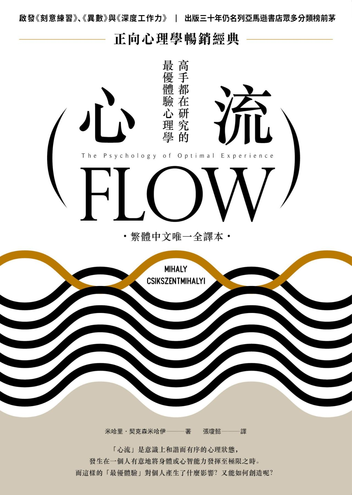

# 《心流：高手都在研究的最優體驗心理學》重點整理

- **作者**：米哈里．契克森米哈伊（Mihaly Csikszentmihalyi），芝加哥大學心理系前教授、正向心理學領航者
- **譯者**：張瓊懿
- **出版**：行路（遠足文化），2019 年 4 月初版（原書 *Flow: The Psychology of Optimal Experience*, 1990）

!!! abstract "一句話總結"

    **幸福不是碰巧遇上，也買不到，而是靠掌控意識培養出來的。** 當我們把身心能力推到極限、全神投入一件有挑戰的事時，就會進入「心流」。每次心流都讓自我更複雜；把整個人生整合成一場心流，生命就有了意義。

---

## 全書架構

| 章 | 主題 | 重點 |
|---|---|---|
| 自序 | 寫作目的 | 提供通用原則，不是快樂公式 |
| 1 | 重新詮釋幸福（Happiness Revisited） | 幸福來自掌控意識；不滿的根源 |
| 2 | 解析意識（The Anatomy of Consciousness） | 注意力＝精神能量；精神熵與心流 |
| 3 | 樂趣與生活品質（Enjoyment and the Quality of Life） | 享樂 vs. 樂趣；心流八大要素 |
| 4 | 心流的條件（The Conditions of Flow） | 心流活動、心流通道、自得其樂的性格 |
| 5 | 身體的心流（The Body in Flow） | 運動、舞蹈、性、瑜伽、武術、視覺、音樂、飲食 |
| 6 | 思想的心流（The Flow of Thought） | 記憶、文字、歷史、科學、哲學、終生學習 |
| 7 | 工作中的心流（Work as Flow） | 自得其樂的工作者；工作的悖論 |
| 8 | 獨處和與他人相處的樂趣（Enjoying Solitude and Other People） | 獨處、家庭、友誼、社群 |
| 9 | 翻轉渾沌（Cheating Chaos） | 轉換逆境；耗散結構；自得其樂的自我 |
| 10 | 創造意義（The Making of Meaning） | 目的、決心、和諧；人生主題 |

### 核心框架一：心流（樂趣）的八大要素（第三章）

| # | 要素 | 說明 |
|---|---|---|
| 1 | 需要技能的挑戰活動 | 困難，但有機會成功 |
| 2 | 行動與意識結合 | 全神貫注，動作像自動發生 |
| 3 | 明確的目標 | 知道下一步要做什麼 |
| 4 | 立即的回饋 | 隨時知道做得好不好 |
| 5 | 專注於手上的工作 | 暫時忘掉日常煩惱 |
| 6 | 掌控感的悖論 | 覺得能掌控，也不擔心失控 |
| 7 | 自我意識消失 | 活動中忘我，事後自我反而更強 |
| 8 | 時間感改變 | 幾小時像幾分鐘，或反過來 |

### 核心框架二：心流通道（第四章）

| 狀態 | 挑戰 vs. 技能 | 怎麼回到心流 |
|---|---|---|
| 心流 | 挑戰 ≈ 技能 | — |
| 無聊 | 技能 ＞ 挑戰 | 提高挑戰 |
| 焦慮 | 挑戰 ＞ 技能 | 提升技能 |

渴望樂趣會不斷把人推回通道，而且每回一次，挑戰和技能都在更高的層次，這就是心流促使人成長的機制。

### 核心框架三：意義的三要素（第十章）

| 要素 | 意思 |
|---|---|
| 目的（purpose） | 人生事件串連起來，指向一個終極目標 |
| 決心（resolution） | 付諸行動，重點在有沒有努力 |
| 和諧（harmony） | 情感、思想、行動一致，不浪費精神能量 |

---

## 前言／作者序
**核心觀點：本書把數十年最優體驗研究寫給一般讀者，提供通用原則，而不是快樂公式。**
- 作者把充滿樂趣、創意、全心投入生活的體驗稱為「心流」。
- 這不是教人「如何快樂」的速成書。作者認為這種書根本寫不出來，因為樂趣因人而異，無法照公式複製。書中不承諾捷徑，但提供把理論化為行動所需的資訊。
- 正文不放學術註解，出處集中在書末加註（例如亞里斯多德的幸福觀），註解可當作原著較技術性的濃縮版來讀。
- 致謝妻子伊莎貝拉、兒子馬克與克里斯多福、導師雅各．蓋哲爾（Jacob Getzels），以及霍華德．嘉納、法斯托．馬西米尼、瑞德．拉森、珍妮．中村等同事和學生；研究經費來自史賓塞基金會。
- 寫於芝加哥，1990 年 3 月。

---

### 第一章｜重新詮釋幸福
**核心觀點：幸福不靠運氣或外在條件，要靠掌控意識自己培養；最美好的時刻來自全力投入有難度的挑戰。**
- **永恆的問題**：亞里斯多德認為人最渴望的是幸福。現代人的物質和科學遠勝古人，卻仍然空虛、焦慮、無聊。
- **幸福是副產物**：幸福取決於怎麼詮釋經驗，要自己醞釀和捍衛，但不能直接去追。作者引用彌爾（J. S. Mill）和法蘭克爾（Viktor Frankl），說明幸福和成功都是全心投入、忘掉自我之後的副產物。
- **最優體驗（optimal experience）**：覺得自己掌控生命、深深喜悅的時刻，例如揚帆的水手、作畫的畫家。這種時刻通常不在放鬆時，而在把身心推到極限、完成困難的事時（孩子疊最高的積木塔、泳者破紀錄、小提琴手練成難段）。當下未必舒服，但累積下來會產生駕馭感，連集中營裡都可能出現。
- **研究方法**：
  - 先訪談數百位藝術家、運動員、棋手、外科醫生等專家。
  - 再與芝加哥大學團隊訪問數千人：韓國老婦、東京少年、納瓦荷族牧羊人、阿爾卑斯山農夫、芝加哥裝配線工人……描述最優體驗的方式都一樣。
  - **經驗取樣法（Experience Sampling Method, ESM）**：受測者戴一週呼叫器，每天在不定時間被呼叫 8 次，記錄當下的心情與想法。至今已收集超過 10 萬份紀錄，並應用在學校、主管訓練、臨床心理、少年感化、養老院等領域。
- **不滿的第一個根源：宇宙並不在乎人類**。作者用「混沌」（chaos）形容宇宙對人類目標的漠不關心：宇宙不是敵對，只是冷漠。
- **第二個根源：期待不斷升高**。基本需求滿足後，新的欲望接連出現（居魯士大帝有一萬名御廚）。註解提到一項 1987 年調查：年收入超過 10 萬美元的人認為舒適生活一年要 8.8 萬美元，其他人則認為 3 萬就夠。
- **文化的保護盾會失效**：宗教、哲學、愛國主義讓人相信自己能掌控世界，但盾牌一破（羅馬、被蒙古征服前的中國、阿茲特克），人就陷入本體焦慮（ontological anxiety），開始問「人生就這樣而已嗎？」
- **無效的應對**：追求更好的車、更大的房子；頭痛醫頭（節食、整形、自信課程）；用酒精藥物退縮；投入宗教（只能提供暫時的答案）。
- **美國社會病態統計**：1960–1986 暴力犯罪增加超過 3 倍；離婚率從 1950 年每千對 31 對升到 1984 年 120 對；精神疾病案例 1955–1975 從 170 萬件增至 640 萬件；青少年自殺率 1950–1980 增加 3 倍；SAT 數學平均從 1967 年 466 分降到 1984 年 426 分。結論：物質能力突飛猛進，生活體驗的內涵卻沒有進步。
- **擺脫社會制約**：社會化讓人依賴外在賞罰，社會利用求生本能和追求快樂的傾向控制人。順從本能或「感覺好就是對的」，等於放棄掌控意識。解法是逐步用自己能控制的獎賞取代社會獎賞。作者引用愛比克泰德與馬可．奧理略：困擾人的是看法，不是事物本身。
- **前人智慧為何沒有累積**：德爾斐神諭、斯多噶、瑜伽、禪宗都在追求意識的自主。但這種智慧無法變成公式，要靠反覆實踐；而且必須隨文化更新，一旦制度化、常規化（routinization）就失效，例如佛洛伊德學說變成教條、馬克思主義變成鎮壓體系。

### 第二章｜解析意識
**核心觀點：意識是有限的、經過整理的資訊，注意力（精神能量）決定什麼能進入意識；資訊與目標衝突就產生精神熵，與目標一致就是心流，並讓自我更複雜。**
- **意識不神祕**：意識是神經系統的產物，功能是評估資訊、排出優先順序，還能創造新資訊。作者採用以資訊理論為基礎的現象學模式，不談神經化學。夢不算意識，因為無法在夢中引導注意力的方向。
- **意圖（intention）**：像磁場一樣把注意力引向目標，並依目標層級排定先後，例如絕食者讓政治目標壓過飢餓。
- **意識的極限**：依米勒（Miller）的推算，人一次最多處理約 7 位元資訊，每秒約 126 位元，一生（70 年、每天醒著 16 小時）約 1,850 億位元。聽懂一個人說話每秒要 40 位元，所以理論上最多同時聽 3 個人。約一半美國成人的休閒時間在看電視，而看電視時的專注與投入最低。**篩選什麼進入意識，就決定了生命的內容。**
- **精神能量（psychic energy）**：注意力負責挑選資訊、喚起記憶、做決定。開車時注意到蛇行的車，就得停止講電話。愛斯基摩獵人能分辨十多種雪，醫生、股票經紀人也各有訓練過的注意力。性格其實就是注意力的配置模式。
- **案例 E 與 R**：E 是歐洲女學者兼企業家，從不浪費時間，每天在湖邊靜立 15 分鐘，靠控制專注力從戰爭的貧困和致命的慢性病中復原。R 是害羞的詩人學者，只觀察、不急著改變，意識的秩序一點也不輸 E。
- **自我（self）**：意識的全部內容與目標層級的總和。注意力塑造自我，自我也塑造注意力。15 歲的山姆．布朗寧在百慕達潛水時愛上海底世界，立志成為海洋生物學家，從此這個目標反過來主導他的注意力。
- **精神熵（psychic entropy）**：與目標衝突的資訊讓意識失序。
  - 焊工胡立歐．馬丁尼茲輪胎漏氣又沒錢修，擔憂占滿心思，工作拖慢、對同事發脾氣。
  - 高中生吉姆．哈里斯被離婚父母爭相拉攏，吞下整瓶阿斯匹靈，幸好被姊姊救回。
  - 事件本身只是資訊，是自我依自身利害賦予它好壞；經濟餘裕、人際支持與自信都能減輕衝擊。
- **心流（精神負熵，negentropy）**：
  - 裝配線工人里可．梅德霖：每件工作標準時間 43 秒、每天重複約 600 次。他像運動員一樣挑戰自己，5 年後平均只要 28 秒，覺得「比看電視還過癮」。
  - 年輕律師潘．戴維斯常專注到忘了吃午餐。
  - 「心流」一詞來自受訪者形容的「被一股水流載著走」。
- **複雜性（complexity）＝ 特化 ＋ 整合**：特化（differentiation）是變得獨特、技能提升；整合（integration）是與他人和世界連結。只特化會自我中心，只整合會失去自主。心流讓自我更複雜，這就是成長。悖論是：唯有單純為了做事本身而投入，自我才會成長。

### 第三章｜樂趣與生活品質
**核心觀點：生活品質取決於經驗的品質，不在擁有多少；讓人成長的是「樂趣」而不是「享樂」，而樂趣有一套跨文化共通的要素。**
- **兩種策略**：改變外在環境，或改變體驗環境的方式。只改外在而掌控不了意識，焦慮仍會回來，就像點石成金、最後餓死的邁達斯國王。
- **財富與幸福只有輕微相關**：迪納（Ed Diener）調查美國最富有的 400 人，他們自認 77% 的時間快樂，一般人是 62%。布雷本（Norman Bradburn）發現最高收入族群的幸福時間只比最低收入族群多 25%。
- **享樂（pleasure）vs. 樂趣（enjoyment）**：
  - 享樂是生理需求或社會期待得到滿足（美食、休息、看電視），只能「恢復」秩序，不會讓人成長。
  - 樂趣帶來新鮮感與成就感，讓人更複雜。它要投入精神能量，當下不一定愉快，事後才覺得過癮。
  - 孩子天生是學習機器，上學後學習變成負擔，成人的正向經驗就只剩享樂。
- **拿坡里古董商歐西尼先生**：客人對天價毫不還價就要買，他反而拒絕成交，因為他要的是討價還價的鬥智樂趣。
- **心流八大要素**：見上方「核心框架一」。八項合起來就是**自成目標的經驗（autotelic experience）**。
- **挑戰與技能**：技能不限於體能，閱讀、與人相處、欣賞畫作都算。競爭只有在追求精進時才有樂趣，只想贏就不好玩。作者的獵犬玩鬼抓人時，會依作者的體力調整繞圈大小，讓難度剛剛好。
- **小小的心流（microflow）**：物理學家邁爾—萊布尼茨在無聊的會議上依固定順序敲手指，加上休止符可組出 888 種變化，重複三次正好約 12 分鐘。塗鴉、哼歌都屬這類，但活動越複雜，樂趣越高。
- **回饋的意義**：外科醫生寧可不要十倍薪水也不轉內科，因為開刀的回饋一目了然。回饋的價值在它的象徵意義：我達成目標了。馬西米尼訪問六百多位盲人，發現他們更重視回饋，心流多來自點字閱讀、禱告、手工。
- **掌控感的悖論**：攀岩者把危險分成客觀的（天候、落石）和主觀的（技能不足），靠訓練消除後者，所以認為爬馬特洪峰比走曼哈頓街頭還安全。樂趣不是來自危險，而是在困難中握有掌控。
- **心流會上癮**：納博科夫筆下的棋手路辛跳樓；棋王墨菲、費雪都脫離了現實。依賴單一秩序，就失去了決定意識內容的自由。
- **忘我不是失去自我**：失去的只是「對自我的意識」。人會與船、山、樂曲、團隊結合成更大的系統，結束後自我更強。這與群眾運動中被動交出精神能量的「自我超越」不同。
- **自成目標（autotelic）vs. 外在導向（exotelic）**：autotelic 來自希臘文 auto（自我）＋ telos（目標），指活動本身就是獎賞。作者一位同事小時候被逼去聽音樂會，某天突然聽懂莫札特序曲的結構，從此愛上音樂。
- **心流是中性的**：竊賊說夜間闖空門最有趣，越戰老兵懷念戰場，歐本海默形容原子彈研究是甜蜜的難題。要分辨好的與壞的心流，享受樂趣時不剝奪他人的樂趣。
- **註解補充**：最初模型以為挑戰與技能都低時也有心流；經驗取樣研究後修正為兩者平衡，**且都略高於個人平常水準**。

### 第四章｜心流的條件
**核心觀點：心流的發生靠兩個條件：活動的結構（心流活動、文化）和個人的能力（自得其樂的性格）；後者可以天生、靠家庭培養，也可以自己鍛鍊。**
- **心流活動**：音樂、登山、舞蹈、航海、下棋、祭典、運動等，都需要技能、有明確目標與回饋，並把人帶離日常的「基本現實」。
- **凱里瓦（Roger Caillois）的四類遊戲**（遊戲泛指一切帶來樂趣的活動）：
  - 競爭性（如運動）：compete 源自拉丁文 con petire，「一起尋找」。
  - 投機性（如骰子、賓果）：樂趣來自彷彿能掌控未來的幻覺，源自占卜。
  - 眩暈性（如旋轉、跳傘、迷幻藥）：改變意識最直接，但代價是失去掌控。
  - 模仿性（如舞蹈、戲劇、扮家家酒）。
  - 共同點是讓人進入新的現實，變得更複雜。
  - 整理者註：書中只用中文名稱，對應的原文分別是 agon、alea、ilinx、mimicry。
- **心流通道圖：學網球的艾力克斯**：A1 剛學、只求把球打過網，難度與能力相當 → A2 技能進步後覺得無聊 → A3 遇到強敵感到焦慮 → A4 面對更高挑戰、具備更高技能，再次進入心流。A4 和 A1 一樣有趣，但複雜得多。重點是**主觀認定**的挑戰與技能。
- **心流與文化**：新幾內亞原住民找跳舞羽毛的時間比找食物還多。宗教是人類最古老的意識秩序建構。作者主張用心流活動來描述一個社會，或許比用生產方式更貼切。
- **用精神熵評比文化（回應文化相對論）**：成員經驗越符合他們自己的目標，社會就越「好」。
  - 負面例子：工業革命時五歲童工每週工作 70 小時以上；多布島人連上廁所都怕被下咒；伊克人極度自私。
  - 正面例子：伊圖里森林的俾格米人；蘇斯瓦印第安人每 25–30 年由長者決定全村遷移，重新找回挑戰；日本伊勢神宮約每 20 年拆掉重建，到 1973 年已重建 60 次。
  - 但能帶來心流不等於道德上良善，例如斯巴達、納粹，以及靠奴隸勞動享有心流的雅典公民。
- **幸福與時間運用**：1976 年蓋洛普調查自認「很幸福」的比例，北美 40%、歐洲 20%、非洲 18%、遠東 7%。美國成人每週實際工作約 30 小時，休閒約 20 小時（電視 7、閱讀 3、積極活動 2、社交 7）。**工作時進入心流的機率是看電視的四倍**，休閒多卻得不到樂趣，是現代最大的諷刺。
- **自得其樂的性格（autotelic personality）**：有能力重組意識，在任何處境中都找得到心流。
- **妨礙心流的個人因素**：注意力太散（思覺失調患者無法過濾刺激，造成快感缺乏），或太僵化（自我意識過剩、自我中心）。
- **妨礙心流的社會因素**：社會脫序（anomie，涂爾幹）對應焦慮；社會疏離（alienation）對應無聊。惡劣的自然環境擋不住心流，壓迫性的社會環境卻能。
- **神經生理證據（珍．漢彌爾頓）**：常有心流的人專注時大腦皮質活化反而**下降**，更省力，表示他們能篩掉無關刺激；但無法證明這是遺傳的。
- **自成目標家庭的五個特徵（凱文．拉森德）**：
  1. 明確：期待、目標與回饋清楚。
  2. 重心：父母在乎孩子當下喜歡什麼，不只關心升學。
  3. 選擇：孩子覺得自己有選擇。
  4. 承諾：足夠的信任，讓孩子敢全心投入。
  5. 挑戰：父母提供逐步提高難度的機會。
- **逆境中的心流（理查．洛根的研究）**：這些人注意環境細節、設定可行目標、靠回饋監控進展、達成後再加碼。
  - 伯尼被納粹單獨監禁時，細細研究床、毯子，丈量牢房。
  - 伊娃．澤賽爾在獄中自製胸罩、在腦中下棋、背自己寫的詩。
  - 北越戰俘飛行員每天想像打高爾夫，出獄後瘦了 80 磅，仍打出好成績。
  - 匈牙利詩人托拉斯．蒂伯與獄友比賽翻譯惠特曼的詩，在塗了肥皂的鞋底用牙籤刻字，背下後再抹掉。
- **關鍵是「不自覺的個人主義」**：目標導向強烈，卻不以自我為中心，精神能量向外投注，才能看清環境、找到契機；只顧呵護自己的人一遇威脅就崩潰。

### 第五章｜身體的心流
**核心觀點：身體的每一種功能，只要用心鍛鍊相關技能，都能成為心流的來源；樂趣取決於「怎麼做」，不在「做什麼」。**
- **身體的價值**：沒有身體就沒有任何體驗。感官不訓練，接收的資訊就雜亂無章。光是動身體不會產生心流，心智也要投入。墨西哥塔拉烏馬拉印第安人過節時在山裡跑上數百英里，連跑步都能變成心流活動。
- **更高、更快、更強**：奧運標語點出所有運動的原則：做得比過去更好。有學者把想脫離地心引力的野心稱為「伊卡洛斯情結」，作者反駁這是健康的表現。
- **把身體活動變成心流的五個步驟**：
  1. 定一個整體目標，加上幾個可行的小目標。
  2. 找出評估進度的方法。
  3. 專注投入，把挑戰拆得越來越細。
  4. 培養與挑戰相當的技能。
  5. 變無聊時就提高難度。
  - 以走路為例：可以設定路線、風格、效率；在城市裡觀察行人、抄近路，或調整步伐讓自己剛好在綠燈時過馬路。
- **經驗取樣的發現**：看電視、開車、駕電動船這類耗錢耗能源的休閒，不如聊天、種花、編織這類花費少但要投入精神能量的活動來得快樂。
- **舞蹈**：可能是最古老、最普遍的心流活動。馬西米尼訪問的芭蕾舞者收入低、常巡演，仍因熱愛而堅持。
- **性愛**：同樣的行為可能帶來痛苦或狂喜，差別在意識與目標。性愛有三個層次：肉體歡愉、浪漫情愫、對伴侶真摯的關心。長期關係要持續發掘彼此的新潛力，提升關係的複雜度。
- **瑜伽：掌控的最高境界**：帕坦伽利約在 1,500 年前把修練分成八個階段：持戒 → 內修 → 坐姿 → 調息 → 感官收攝 → 專注 → 冥想 → 三摩地。有人說瑜伽要消泯自我、心流要提升自我，作者認為這只是表面差異，因為八個階段中有七個都在培養控制意識的技能。
- **武術**：受道教與禪宗影響，目標是不經思考就出招，格鬥變成身心合一的表演。
- **視覺**：看畫的衝擊像肚子挨了一拳；通勤族從高架火車俯瞰屋頂，覺得像穿過一幅精確主義畫作。
- **音樂**：音樂是有組織的聲音資訊，能降低精神熵。聆聽分三個階段：感官 → 比擬（聯想情感或景象）→ 分析（聽結構、比較不同版本）。學校刪預算時，音樂、體育、藝術總是先被犧牲；父母只重表現也有害，鋼琴神童荷蘭德青少年時在台上手突然僵住。學音樂永遠不嫌晚。
- **飲食**：經驗取樣顯示用餐是最放鬆愉快的時段。料理的發展也照著心流原則：先認識食材特性，再實驗組合。
- **節制與自由**：壓抑會讓人僵化；出於自願、有紀律的節制，才能享受而不上癮。不需要天賦或大錢，挑一兩項被忽略的身體機能去探索，就能大幅提升生活品質。

### 第六章｜思想的心流
**核心觀點：記憶、語言、歷史、科學、哲學等符號系統，能讓心靈不靠外在刺激也能自己建立秩序；以業餘者的心態持續學習，就能從思考中得到深刻的樂趣。**
- **心靈本來就容易失序**：獨處無事時，思緒常飄向最煩惱的事，許多人於是靠電視填滿心思。耶魯心理學家辛格指出，白日夢其實能幫人整理情緒、預演情境，但很多孩子沒學會。
- **記憶是科學之母**：記憶女神是九位繆斯的母親。作者的祖父 70 歲時還能用希臘文背出 3,000 行《伊利亞德》。廢除「死背」是誤解，腦中有存貨的人比較能自娛、比較不依賴外在刺激。
- **怎麼練記憶**：選一個有興趣的主題（詩、美食、戰史、棒球），自己決定要記什麼，不要變成外加的差事，也別拿來炫耀。
- **心靈遊戲的規則**：命名是建立秩序最基本的方式。哲學與科學因為思考令人愉悅而誕生，外在力量只能決定哪些觀念受重視，無法解釋觀念如何產生。德謨克利特沉思時同鄉以為他病了；牛頓曾把手錶當雞蛋丟進鍋裡煮。逆境中，擁有內在符號系統的人比較撐得住；缺乏內在規則的人，容易被媒體與推銷者擺布。
- **文字遊戲**：自己出字謎比只解字謎更自主。和孩子玩雙關語；每晚讀一點詩，找到一句打動自己的就夠了。詩人柯赫教貧民窟孩子和養老院老人寫詩。寫日記、寫信的重點是「創造資訊」。
- **親近歷史**：每個人都是自己的歷史學家。可以循序漸進：寫日記 → 記錄家族 → 研究族群 → 社區或國家 → 某個主題。
- **科學中的喜悅**：
  - 孔恩說正規科學的魅力就像解謎。
  - 錢卓塞卡在 1950 年代每週兩次開車往返約 80 英里，只為兩名選課學生上課，兩人後來都得了諾貝爾獎，他本人也在 1983 年獲獎。
  - 許多科學家起初都是業餘者：哥白尼是教士、拉瓦吉耶是稅務官、孟德爾是神職人員、愛因斯坦是專利局職員。
  - 業餘科學需要好奇心、觀察、系統紀錄、找出規律，並願意放棄沒有根據的信念。
- **愛上智慧（哲學）**：業餘哲學家可以直接面對基本問題：找出自己關心的問題 → 閱讀、談話、聆聽 → 依興趣深入（本體論、倫理學、美學）。專門化只是手段，不是目的。
- **業餘與專業**：amateur 源自拉丁文「愛」，dilettante 源自「樂在其中」，原本都著重體驗而非成果。風險在於分不清內外目標：李科森（Lysenko）依意識形態推行農業政策，造成蘇聯數十年饑荒。
- **終生學習**：放棄符號技能不會讓人自由，只會被社論、電視和「專家」左右。學校教育結束時，正應該開始出於內在動機的學習。
- **註解補充**：一項研究請成功人士排序 33 種成功特質，「樂在工作」得分最高（9.86／10）。

### 第七章｜工作中的心流
**核心觀點：工作其實比休閒更容易帶來心流，但要兩件事一起做：把工作改造得像心流活動，也培養自得其樂的性格。**
- **工作的差異**：需要複雜技能、又能自主完成的工作會提升人的複雜性；不需技能、被迫去做的工作則帶來精神熵。佛洛伊德的幸福處方是：工作與愛。
- **自得其樂的工作者**：
  - **瑟拉菲娜．薇儂**（76 歲，義大利阿爾卑斯山村）：擠奶、放牧、修果樹、紡紗就是最大的樂趣，問她如果有無限時間和財富想做什麼，答案還是這些。村裡最年長的居民都不區分工作與休閒，孫子輩才開始想少工作、多休閒。
  - **喬．克拉瑪**（芝加哥鐵路車輛廠焊工）：小學四年級輟學，在廠裡 30 多年，多次拒絕升領班。他會修廠裡每一台機器，方法是設想自己就是那台壞掉的機器。他在家自製灑水器和泛光燈，晚上也能造出彩虹。
  - **庖丁解牛的「遊」**：作者認為庖丁遇到難處時放慢、專注，可見「遊」同樣靠新挑戰加新技能，東西方最高的喜悅其實相通。
  - 三人的共同點：在看似卑微重複的工作中，看到別人看不到的行動機會。
- **自成目標的工作**：工作越像遊戲（有變化、挑戰適中、目標明確、回饋即時）就越有樂趣。狩獵、牧羊天生具備心流特徵；農耕重複、回饋慢，比較難享受。北義大利比耶拉的家庭織布工至今自己設計圖樣、決定銷路，全家都說織布比旅遊、看電視有趣。
- **外科醫師**：手術目標明確、回饋即時、挑戰充足，但只做重複小手術的醫師覺得無聊，甚至酗酒賭博。可見工作具備心流條件，也還要看做的人。
- **工作的悖論（ESM 研究，100 多名全職工作者、4,800 多份回應）**：
  - 真正在工作時，心流比例 54%；休閒時只有 18%。冷漠在工作時占 16%，休閒時超過 52%。
  - 工作時的心流比例：主管 64%、職員 51%、藍領 47%。
  - 但人們在工作時仍然更希望「在做別的事」。作者認為原因是忽略了當下的感受，套用「工作是被迫的」這種文化刻板印象。
- **工作不滿的三個來源**（薪水通常不是重點）：
  1. 缺乏變化與挑戰：取決於看事情的角度。
  2. 與他人（尤其上司）的衝突：追求自己目標時，也幫上司和同事達成他們的目標。
  3. 壓力與疲累：靠組織工作、分配責任、溝通、改善家庭與休閒等方法處理。
- **虛度的空閒**：休閒缺少架構，要花更多力氣才會有樂趣。休閒工業讓人看人打球、聽唱片，用被動、替代性的參與取代實際行動，像寄生蟲一樣吸走精神能量。

### 第八章｜獨處和與他人相處的樂趣
**核心觀點：人際關係是最大的快樂來源，也是最大的痛苦來源；要把家庭、友誼、社群經營成心流活動，也要學會在獨處時自己掌控意識。**
- **群居與獨處的衝突**：被孤立是最重的懲罰之一（羅馬人的放逐僅次於死刑）；希臘文 idiot 原指「獨處、不向他人學習的人」。人和家人朋友在一起時最快樂，但最痛苦的經驗也幾乎都牽涉人際，因為人是環境中變化最大的因素。
- **人際關係可以重新定義**：作者 12 歲的兒子馬克被三名青年搶劫，他追上去說明手錶是爸媽送的生日禮物，對方投票以 2:1 決定還他。他把對方當成可以講理的人，改變了互動規則。
- **獨處的痛苦**：成人醒著的時間約 1/3 是獨處，最糟的經驗多發生在獨處又無事可做時。獨居又不上教堂的人，星期日早上情緒最低落。
- **逃避獨處**：電視、藥物、強迫性行為、賭博。這些只是在抵抗焦慮，而不是靠成長消弭混沌。
- **學會獨處**：青少年若無法獨處，就學不會抽象符號技能。研究顯示繼續修數學的資優生，課外花 15% 時間學習、14% 社交；放棄數學的學生只有 5% 學習、26% 社交。
- **馴服孤獨的案例**：
  - 桃樂絲喪夫後獨居邊境小島，嚴守作息、布置環境，在荒野中建立自己的秩序。
  - 蘇珊．布契在阿拉斯加養 150 隻雪橇犬，每天照顧 16 小時，熟知每隻狗的血統和脾性。
  - 單人航海者在無風的日子把壞蛋砸在甲板上再清理，硬是給自己找事做。
- **家庭心流的條件**：
  - 共同目標，包括長期的（房子、教育）和短期的（野餐、週日桌遊），並盡量貼近個人目標。
  - 兼具分化（鼓勵每個人發展獨特性）與整合（彼此的事互相牽動）。
  - 溝通暢通、回饋清楚：作者家原本固定去動物園，長子 10 歲時不忍看動物被關，就該換新的家庭活動。
  - 承諾即解放：自願投入婚姻，就省下反覆衡量「選對人沒有」的精神能量。
  - 家庭像合資企業，需要持續投入，不會自己運轉。
- **青少年**：社會無法提供與他們技能相稱的挑戰，他們只好轉向破壞、犯罪、吸毒。青少年與父親單獨相處平均每天只有 5 分鐘，其中一半在看電視。
- **友誼**：
  - 朋友是自己選的，所以和朋友相處時情緒最正面。
  - 克里斯（15 歲，內向）有計畫地改造外型、對鏡練笑，後來在校園音樂劇擔任主角，關鍵是他把「變受歡迎」當成從小挑戰開始的心流活動。
  - 親密友誼要不斷找新挑戰：更了解對方，也揭露更多自己。家人給情感保護，朋友是冒險與探索的夥伴。許多事業有成的男性很孤單，因為友誼也要用心經營。
- **更大的群體**：真正的挑戰是為他人帶來實際益處。童軍、讀書會、社區清潔，只要設目標、集中注意、留意回饋，都能產生心流。評斷社會、學校、工廠的好壞，應該看它能不能讓人發揮潛能。結尾引卡萊爾：改造你自己，世上就少一個無賴。

### 第九章｜翻轉渾沌
**核心觀點：能不能把逆境變成樂趣，不在健康、財富等外在條件，而在把逆境看成威脅，還是看成可以行動的挑戰。**
- **主觀體驗就是生活的全部**：物質條件只能透過體驗間接發揮作用。
- **改造悲劇（馬西米尼的研究）**：
  - 癱瘓者大多認為致殘的意外是一生中最負面、也最正面的事件，因為它刪去多餘選項、留下明確目標。路西歐 20 歲因車禍下半身癱瘓，之後成為稅務顧問，還坐輪椅贏得射箭冠軍。
  - 失明者保羅在身障游泳賽得到第七名、在西洋棋賽奪冠；天生失明的迪諾在修補藤椅時得到心流。
  - 埃及人里亞在六日戰爭後徒步到歐洲，露宿米蘭公園，靠祈禱集中注意力，把旁人眼中難以承受的生活過得有意義。
- **抗壓能力的三個來源**：外在支持（社交網絡）、個人心理資源、應付壓力的策略。只有最後一項最有彈性、也最能自己掌控。
- **兩種反應**：成熟的抵禦（mature defense，威朗特追蹤哈佛畢業生 30 年提出），又稱轉換性適應（transformational coping）；以及神經性抵禦，又稱退化性適應。財務分析師吉姆 40 歲被解僱，可以借酒澆愁，也可以冷靜分析、重新定義問題、去進修。
- **耗散結構（dissipative structures）**：普里哥基尼的概念，系統利用原本會散失的能量建立秩序，例如植物把陽光變成果實。勇氣、韌性、轉換性適應就是心靈的耗散結構，能把負面事件變成成長的挑戰。
- **轉換技能約在青春期後期發展**：健康青少年的低落情緒約持續半小時，成人約要兩倍。數學家拉馬努金在貧病中仍專注數學。
- **把逆境變成心流的三個步驟**：
  1. **不自覺的自信**（洛根）：相信命運在自己手中，卻不以自我為中心，把自己看成系統的一部分，就像好的飛行員把自己當成「人與飛機」系統的零件。
  2. **把焦點放在外在世界**：保持開放，精神熵較少、較易找到出路。反例：韓戰中一名士兵拿到開傘繩在左邊的降落傘，墜落時只在慣用的右側亂抓，結果墜地身亡。
  3. **尋找新的解法**：移除障礙，或看整個系統、調整目標。就像有創意的畫家隨畫布的變化調整構想，作者發現這樣作畫的藝術學生 18 年後比較成功。
- **自得其樂的自我（autotelic self）的四個培養規則**：
  1. **設立目標**：目標、挑戰、技能互相界定，而且目標必須是自己選的。
  2. **全心投入**：在行動機會與技能之間取得平衡。
  3. **注意當下發生的事**：持續投入注意力，放下自我意識。
  4. **學習樂在當下**：一陣微風、一杯水都能帶來樂趣，但這需要決心與紀律，不是享樂主義。
- **銜接下一章**：從一個心流活動跳到另一個還不夠，要有整體目標，把人生整合成一場心流。

### 第十章｜創造意義
**核心觀點：人生的意義就是找到一個能整合一切的終極目標，帶著決心去追求，讓意識達到和諧，把整個人生變成一場連續的心流。**
- **片段的心流不夠**：網球名將下場後冷漠難親近，棋王費雪除了下棋什麼都笨拙。
- **回應「生命本無意義」**：適用所有人的超級目標確實不存在，但就像沒有翅膀也不妨礙人類飛行，人仍能賦予自己的生命意義。從收集啤酒瓶到治療癌症，任何方向清楚、規則明確的目標都可以。
- **意義三要素**（見上方「核心框架三」）：拿破崙追求權力、德蕾莎修女奉獻給弱者，兩人在心理上都達到內在秩序，道德後果卻截然不同。重點不在有沒有達成目標，而在有沒有努力過。
- **索羅金的三種文化**：
  - 感官文化（sensate）：重享樂和實用，規則易懂、回饋清楚。
  - 理念文化（ideational）：追求超自然與抽象原則，帶禁慾色彩，沒人能證明你失敗。
  - 理想文化（idealistic）：兼顧感官與精神，最理想但最難做到。
  - 作者認為，比內容是物質還是理念更重要的，是目標的複雜性：能否既分化又整合。
- **自我發展的四個階段**：(1) 求生存與享樂；(2) 擴及家庭、社群、國家，遵循群體規範；(3) 回到反思的個人主義，追求成長，獎賞從享樂轉為樂趣；(4) 再度向外，融入他人與宇宙。多數人停在第二階段。
- **選擇變多，決心變弱**：現代人可以換工作、換住處、換信仰，選項多了，自由不一定讓生命更有意義。作者不主張回到過去，而是要征服這個挑戰。
- **行動生活 vs. 沉思生活**：行動（vita activa）消除內在衝突，但選擇太受限，像立志 45 歲當上廠長的工程師，日後可能懷疑懊悔。沉思（vita contemplativa）像心理分析或耶穌會士每天反省良知。兩者要相輔相成：行動是盲目的，反思是無能的。
- **投入前先問自己五個問題**：
  1. 這真的是我想做的嗎？
  2. 做的時候能樂在其中嗎？
  3. 在可見的未來還能從中得到樂趣嗎？
  4. 值得我或別人付出代價嗎？
  5. 我能接受做了這件事的自己嗎？
- **和諧回不去了**：獅子的需求和技能總是相稱，幾乎時時處於心流；孩子在自我意識出現前也是。但意識變複雜後，單純的和諧既脆弱又回不去，伊甸園之路已不存在。
- **人生主題（life theme）**：
  - 發現性人生主題（discovered）：自己寫的劇本。接受性人生主題（accepted）：照別人的劇本演。
  - 接受性主題的風險：艾希曼只知奉命行事，社會失序時就成了罪行幫凶。發現性主題的風險：不易得到認同，例如麥爾坎．X 在獄中靠閱讀找到新目標。
  - **E 的案例**：7 歲時新腳踏車被有錢醫生撞毀，醫生答應賠償卻消失，父親從此消沉。E 十四、五歲讀到美國憲法與人權法案，明白問題在弱勢者不懂自己的權利，後來成為律師、法官、內閣成員，推動民權。
  - 發現性主題常源於早年創傷，關鍵在怎麼解讀：把苦難解讀成可以解決的挑戰，就是耗散結構。葛特佛烈德 10 歲時母親死於癌症，後來成為癌症研究專家；葛蘭西天生駝背、家貧，仍成為國會議員。
- **向文化汲取秩序**：找到人生主題的人往往記得小時候父母講故事給他們聽。作者在主管的中年危機講座上用但丁《神曲》開場：但丁在人生中途迷失於幽暗森林，由維吉爾帶他穿越地獄；他的信仰是自己發掘、融合了希臘與伊斯蘭智慧的。啟示是用親身經驗檢驗信仰體系，保留有意義的部分。
- **未來的意義體系**：新的信仰必須與科學一致。作者提出以**演化**為基礎：複雜化是應有的方向，人類過去擅長分化，接下來的任務是整合，與他人重新結合又不失個人特色。把個人目標融入宇宙的心流，人生意義的問題就能解決。註解也提醒：演化不保證進步，結果取決於我們接下來的選擇。

---

## 貫穿全書的核心觀念／實用心法

1. **幸福要自己培養**：幸福取決於怎麼詮釋經驗，而經驗由注意力決定。掌控注意力，就是掌控生活品質。
2. **追求樂趣，不只是享樂**：享樂只能恢復秩序，樂趣要投入精神能量，會讓人成長。
3. **讓挑戰略高於技能**：無聊就提高挑戰，焦慮就提升技能，每回到心流通道一次，自我就更複雜一點。
4. **把任何活動遊戲化**：設定明確目標、找到即時回饋、把挑戰拆小、專注投入。走路、洗碗、裝配線工作都能變成心流。
5. **工作比休閒更容易進入心流**：別被「工作是被迫的」這種刻板印象騙了；少一點被動休閒（電視），多一點需要技能的活動。
6. **注意力向外，不以自我為中心**：自我意識過剩會擋住心流；忘我之後，自我反而更強大。
7. **逆境是資訊，不是判決**：用轉換性適應取代退化性適應，把苦難解讀成可以行動的挑戰（心靈的耗散結構）。
8. **兼顧特化與整合**：發展獨特技能，也要與家人、朋友、社群連結。
9. **終生做業餘者**：學校教育結束後，出於興趣持續學習記憶、詩、歷史、科學、哲學，建立內在的符號秩序。
10. **找到自己的人生主題**：用五個問題檢驗目標，帶著決心追求，讓整個人生成為一場心流。

---

整理說明：依電子書全文整理，涵蓋自序與第 1–10 章正文。各章章末註解已閱讀，只摘錄少數補充數據（標示「註解補充」）；書末參考文獻、版權頁、獻詞與空白頁未納入。本版電子書沒有只含圖片的章節。
