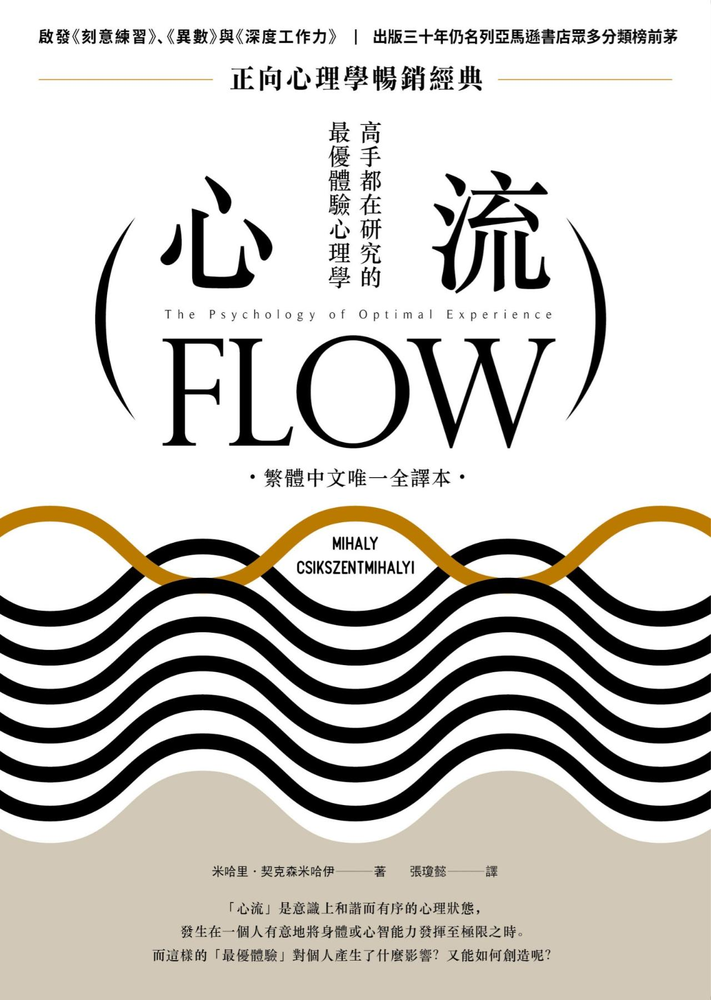
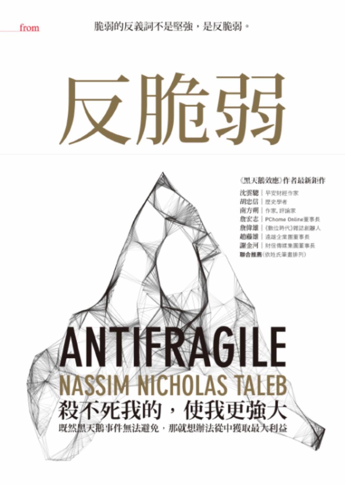
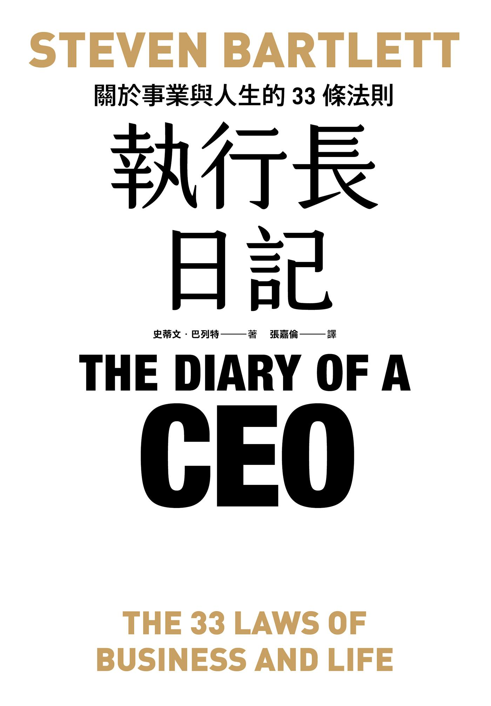

# 讀書筆記

每本書整理成一頁重點筆記：全書架構、各章重點與實用心法。用右側的「本頁目錄」可以直接跳到想看的章節。

## 書單

| 封面 | 書名 | 分類 | 一句話 |
|---|---|---|---|
|  | [《心流：高手都在研究的最優體驗心理學》](flow.md) | 心理與成長 | 幸福不是碰巧遇上，也買不到，而是靠掌控意識培養出來的。 |
|  | [《反脆弱：脆弱的反義詞不是堅強，是反脆弱》](antifragile.md) | 思維與決策 | 每一件事都會從波動中得利或受損。 |
|  | [《執行長日記：關於事業與人生的33條法則》](diary-of-a-ceo.md) | 商業與職涯 | 不會過時的 33 條事業與人生法則。 |
